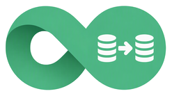
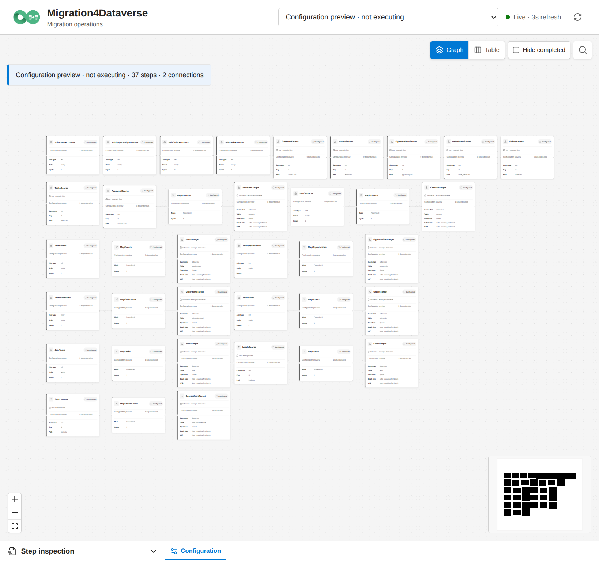
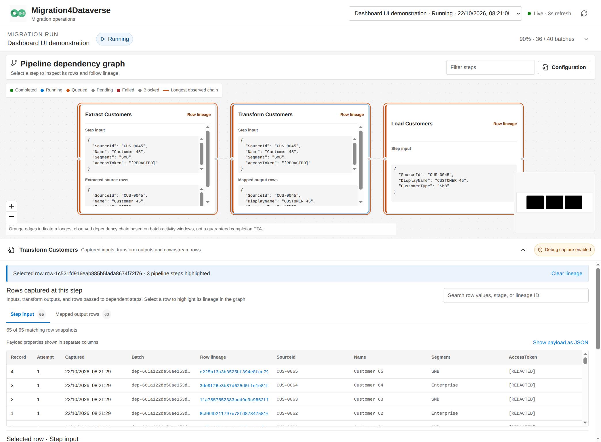
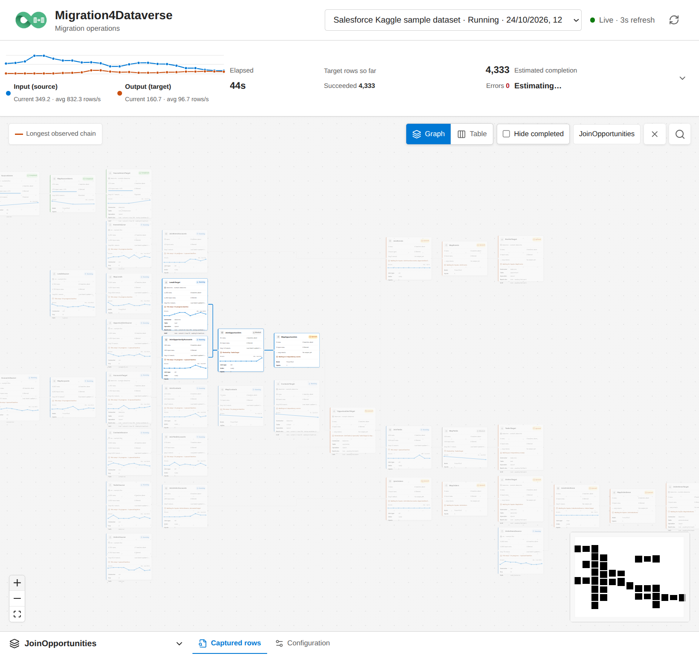
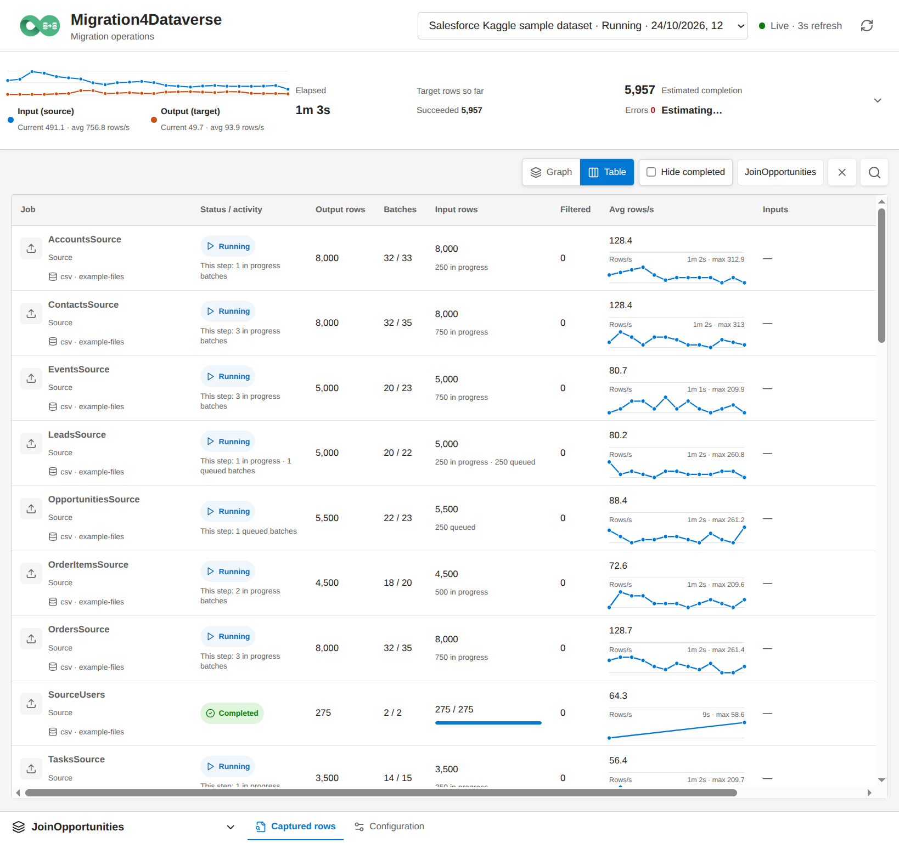
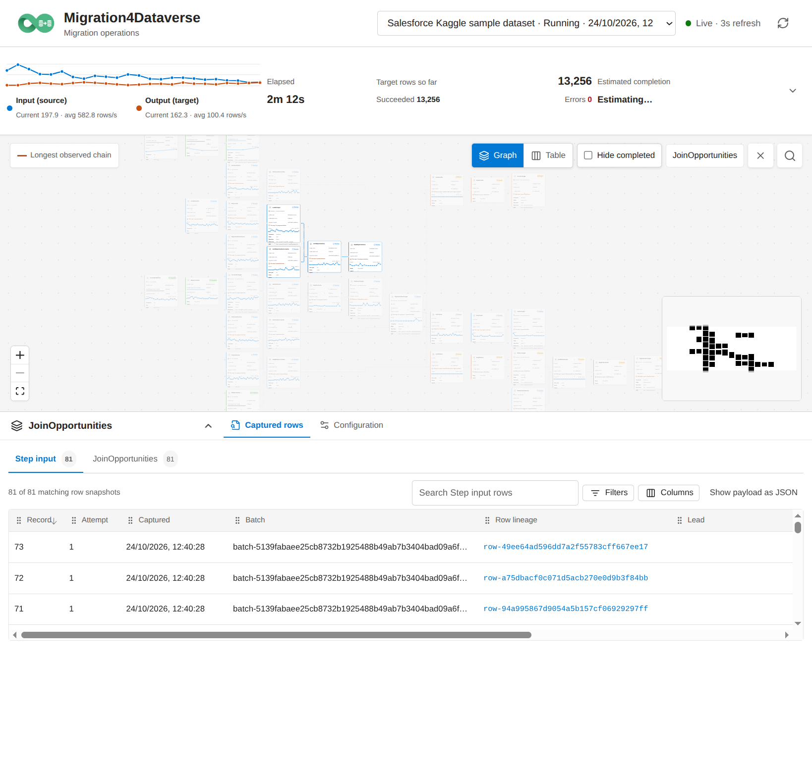
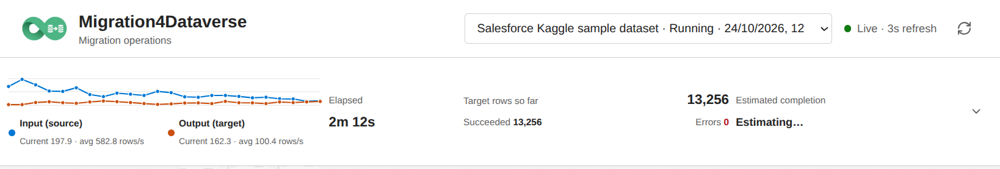

<p align="center">
  
</p>

# Migration4Dataverse

**A PowerShell-hosted, C#-backed migration engine for Microsoft Dataverse and local data pipelines.**

> [!WARNING]
> This repository is an early POC, not a production-ready implementation.

The repository contains two related but separate surfaces: a generic PowerShell `Invoke-Migration` host with standalone examples, and a reusable C# batch-DAG engine. The Dataverse connector uses [`Rnwood.Dataverse.Data.PowerShell`](https://github.com/ALM4Dataverse/Rnwood.Dataverse.Data.PowerShell).

## Why Migration4Dataverse?

Migration configuration, mapping, and custom callbacks are ordinary PowerShell scripts: readable, versionable, and easy to adapt without requiring a compiled extension for every transformation. The C# engine handles scheduling, persistence, and batching, while PowerShell remains the flexible orchestration layer.

The runtime needs PowerShell 7.6+ and the .NET 10 SDK; it does not require SSIS, SQL Server, or an Azure-hosted execution service. It is designed for single-machine migration runs rather than distributed scale-out.

Each migration SQLite database has one local owner process that centralizes all engine and dashboard store access. The owner starts implicitly on first use, or can be started explicitly with [`Start-MigrationDatabaseServer`](./docs/cmdlets/migration-database-server.md) when multiple PowerShell processes need to share the database. Schedulers and PowerShell callbacks remain in their caller processes, and multiple run IDs can execute concurrently through one owner.

## Current capabilities

- A declarative step graph with named connections, connector-backed sources and targets, transforms, filters, keyed joins, and custom PowerShell callbacks.
- Streaming one- and multi-parent relationships: join children to keyed parent rows as they become available instead of waiting for every parent job to finish. Unmatched non-null keys fail clearly; null relationship keys remain unjoined.
- Bounded, fair scheduling with per-step queue limits and downstream-capacity reservations, so a slow fan-out branch is less likely to starve other branches.
- Checkpoints and replay-aware targets for recovery; Dataverse targets can tune batch size and concurrency automatically within configured limits.
- Embedded SQLite and DuckDB connectors and database-backed transforms for local staging and SQL-based processing without a separate SQL Server service.
- Optional efficient source totals from supported query/count providers, without streaming the full source solely to count it.
- A local dashboard for live input/output throughput, target progress and outcomes, execution timeline, runtime hotspots, and optional captured-row lineage.

## How it works

PowerShell defines a directed acyclic graph of migration steps and named connections. The C#/.NET engine schedules bounded batches, coordinates row-flow and completion dependencies, and persists run state for recovery. Optional debug capture records inputs and outputs for row tracing. When an operation is easier to express with staging or SQL than as a streaming step, SQLite or DuckDB connectors can persist data locally and feed query results into later steps; database-backed transforms can also use a live connection. Both are embedded databases, so these workflows do not require a separate SQL Server service.

The standalone data-flow API separately provides streaming Append, sorted Merge, external-memory Sort, Transform, and Filter nodes. See the [transformation reference](./docs/transformations/README.md), [step configuration](./docs/configuration.md), and [developer engine overview](./docs/dev/engine-overview.md) for usage and implementation details.

For operations that are not practical as a streaming transform, SQLite and DuckDB connectors and database-backed transforms can stage and query data locally. These embedded engines provide set-based SQL without requiring a separate SQL Server service, while keeping data processing flexible and performant.

### Brief configuration and invocation

Steps are ordinary PowerShell hashtables. This small CSV-to-Dataverse example declares a source, a row transform, and an upsert target, then runs the graph with `Invoke-Migration`:

```powershell
$steps = @(
    @{
        Id = 'AccountsSource'
        Type = 'source'
        Inputs = @()
        Source = @{
            Type = 'csv'
            ConnectionId = 'files'
            Path = 'account.csv'
            Key = 'id'
        }
    }
    @{
        Id = 'MapAccounts'
        Type = 'transform'
        Inputs = @('AccountsSource')
        Script = {
            param($row)
            @{
                new_salesforceid = [string]$row.id
                name = [string]$row.name
            }
        }
    }
    @{
        Id = 'AccountsTarget'
        Type = 'target'
        Inputs = @('MapAccounts')
        Target = @{
            Type = 'dataverse'
            ConnectionId = 'crm'
            Table = 'account'
            Operation = 'Upsert'
            BatchSize = 'auto'
            Options = @{ MatchOn = ,@('new_salesforceid') }
        }
    }
)

$connections = @{
    files = [System.IO.DirectoryInfo]'/data/import'
    crm = $dataverseConnection
}

Invoke-Migration -DatabasePath './migration.sqlite3' `
    -RunName 'Account import' -Steps $steps -Connections $connections
```

## Examples: standalone PowerShell migrations

Each target example has its own `example.ps1` migration and `Setup-Example.ps1` setup script. The Dataverse example imports the complete Salesforce-style Kaggle CRM dataset; the file and callback examples use the smaller generated Accounts sample:

```text
AccountsSource -> NormalizeAccounts -> Accounts
```

| Target | Example | Setup | What it demonstrates |
| --- | --- | --- | --- |
| Dataverse | [`example.ps1`](./examples/dataverse/example.ps1) | [`Setup-Example.ps1`](./examples/dataverse/Setup-Example.ps1) | Imports the 257,375-row [Sample Sales CRM Data](https://www.kaggle.com/datasets/sushicatsan/sample-sales-crm-data) dataset using independent sources and streaming joins to written parent records. |
| Dataverse (sequential) | [`example-sequential.ps1`](./examples/dataverse/example-sequential.ps1) | [`Setup-Example.ps1`](./examples/dataverse/Setup-Example.ps1) | Runs dependent jobs after their parent targets finish; alternate-key lookup columns avoid parent rereads where possible. |
| JSON Lines | [`example.ps1`](./examples/jsonl/example.ps1) | [`Setup-Example.ps1`](./examples/jsonl/Setup-Example.ps1) | Writes migration batches as JSONL files. |
| CSV | [`example.ps1`](./examples/csv/example.ps1) | [`Setup-Example.ps1`](./examples/csv/Setup-Example.ps1) | Defines step-keyed CSV columns and output options inline with the target connector. |
| Parquet | [`example.ps1`](./examples/parquet/example.ps1) | [`Setup-Example.ps1`](./examples/parquet/Setup-Example.ps1) | Defines a step-keyed Parquet schema and output options inline with the target connector. |
| SQLite | [`example.ps1`](./examples/sqlite/example.ps1) | [`Setup-Example.ps1`](./examples/sqlite/Setup-Example.ps1) | Reads and writes separate SQLite databases, auto-creates the output table, and runs a per-row PowerShell transform with a live SQLite connection. |
| DuckDB | [`example.ps1`](./examples/duckdb/example.ps1) | [`Setup-Example.ps1`](./examples/duckdb/Setup-Example.ps1) | Reads and writes separate DuckDB databases and runs a prepared per-row DuckDB statement. |
| Custom PowerShell | [`example.ps1`](./examples/custom/example.ps1) | [`Setup-Example.ps1`](./examples/custom/Setup-Example.ps1) | Uses a custom PowerShell callback for the target. |

Each `example.ps1` declares top-level Source, Transform, and Target nodes; the Dataverse example also demonstrates keyed Join nodes. The non-Dataverse setup scripts also exercise the separate data-flow API with inline Transform and Filter nodes.

### Run an example

The examples require the .NET 10 SDK and PowerShell 7.6 or later. Run setup and migration for one target from the repository root. For example:

```powershell
pwsh ./examples/jsonl/Setup-Example.ps1
pwsh ./examples/jsonl/example.ps1
```

For the Dataverse example, install [`Rnwood.Dataverse.Data.PowerShell`](https://github.com/ALM4Dataverse/Rnwood.Dataverse.Data.PowerShell) and use an identity with permission to customize the standard tables, create alternate keys, and write records in the configured organization. Setup downloads and sorts the pinned Kaggle v1 archive by source keys in the ignored `generated-data` folder, then saves a device-code-authenticated connection profile named `Migration4DataverseExample`. The example reuses that profile. One `Invoke-Migration` call imports all nine CSVs; independent source readers run without unnecessary parent-source gates, and streaming joins resolve foreign keys to written Dataverse records as they become available. Each target uses the `new_salesforceid` alternate key, including lookup resolution by alternate key. It imports Salesforce users to a custom source-user table because synthetic users cannot be provisioned as Dataverse `systemuser` records. Dataverse assigns created rows to the signed-in user; original owner IDs and complete source rows are retained in custom columns. The example opens the local dashboard during and after the run. It uses the only active price list in the configured organization; dataset monetary values have no source currency and are interpreted in that price list's currency.

```powershell
Install-Module Rnwood.Dataverse.Data.PowerShell -Scope CurrentUser
pwsh ./examples/dataverse/Setup-Example.ps1
pwsh ./examples/dataverse/example.ps1
pwsh ./examples/dataverse/example-sequential.ps1
```

`example-sequential.ps1` uses the same setup and connection profile, but records its run in `generated-data/migration-sequential.sqlite3`. `DependsOn` completion barriers keep dependent sources behind their parent targets. Contacts, opportunities, orders, and order items resolve lookup values through alternate keys without rereading those parent rows; activities still reread their polymorphic regarding records. Independent root jobs can still run concurrently. Opportunities use `CreateOrUpdateIfNeeded`, which skips unchanged records. Set `$env:M4D_SEQUENTIAL_RUN_ID` to resume one of these sequential runs.

To resume an interrupted Dataverse run, set `$env:M4D_RUN_ID` to that run's stored ID before running `example.ps1`; this reuses the existing checkpoints and migration database.

Dataverse auto batch-size experiments are serialized across the pipeline and scored against total successful target throughput. Auto concurrency shares one adaptive budget per connection and uses available retry/throttle telemetry; both values persist in the migration SQLite database and are reused when compatible with the target and connection. Normal retries remain enabled; `-DataverseNoRetryDiagnosticMode` is available for deliberate no-retry diagnostics. Clear a single target profile or all saved profiles with `Clear-MigrationTargetTuning`.

The CSV, JSON Lines, Parquet, SQLite, DuckDB, and custom examples are small demonstrations. The Dataverse example processes the full Kaggle dataset (257,375 rows) using 250-row batches and 32 scheduler workers; targets sharing a connection use the same adaptive concurrency budget. Debug capture is enabled for lineage and stores payload snapshots in the SQLite migration database, so expect substantially higher local storage use than the source CSV size. To change source, target, or run settings, edit the relevant `example.ps1`. See the [step and connector reference](./docs/reference.md) for supported options and callback contracts.

## Live migration dashboard demo

The engine includes a local React dashboard using Fluent UI 9, including Fluent DataGrid for captured rows, and an interactive React Flow dependency graph. Every configured step remains a separate node; source and target connection details are shown on applicable steps. The graph fills the workspace below the header, with a collapsible run overview above, configuration properties in a right-side drawer, and searchable row inspection in a lower drawer. With debug capture enabled, browse snapshots by stage, switch between individual payload columns and JSON, sort and filter rows, resize and reorder columns, and choose visible columns from a searchable checklist. Payload values have a copy action on hover. Select a row to show its lineage values and the number of highlighted steps in the graph. Merged rows can link to multiple predecessor rows; the graph limits each stage to a compact preview while the searchable row inspector provides the full trace. Completed runs retain step and safe connection metadata for inspection. Try the synthetic, Dataverse-free demo (requires Node.js/npm, .NET 10, and PowerShell 7.6+):

```powershell
pwsh ./examples/dashboard/Setup-Example.ps1
pwsh ./examples/dashboard/example.ps1
```

Open the printed `http://127.0.0.1:5180` URL while the 48-batch sample runs. Afterward, the server remains available for completed-run inspection until you press Enter. `Start-MigrationDashboard -Steps $steps -Connections $connections` also opens a configuration preview without executing a migration; use [`Get-MigrationRun`](./docs/cmdlets/get-migration-run.md) to list or inspect saved execution history. See the [dashboard guide](./docs/cmdlets/migration-dashboard.md) for retention and security details.

For multiple independent PowerShell processes sharing a database, start [`Start-MigrationDatabaseServer`](./docs/cmdlets/migration-database-server.md) in a dedicated process first. The owner keeps SQLite access in one process while migration schedulers and callbacks stay with their callers; distinct run IDs can run concurrently through it.

**Complex engine graph:** configuration-only preview of the 37-step Dataverse sample, showing independent sources, streaming joins, transforms, and targets. No migration is executing.



**Dashboard UI:** a running sample with its dependency graph, captured rows, and selected-row lineage.



### Screenshots from the running Dataverse example

These views were captured during the full Salesforce Kaggle migration, using its 37-step graph and live run progress:









## Documentation

- [Documentation index](./docs/README.md) — public cmdlets, step configuration, concepts, connectors, and transformations.
- [Feature plan](./PLAN.md) — current implementation status and remaining work.
- [Developer documentation](./docs/dev/README.md) — engine overview, architecture, and implementation guidance.

## General C# engine

The reusable C# scheduler and the PowerShell examples are separate surfaces. For the C# API, scheduler behavior, transformations, build and test instructions, and current project limitations, see the [developer engine overview](./docs/dev/engine-overview.md) and [architecture guide](./docs/dev/architecture.md).
