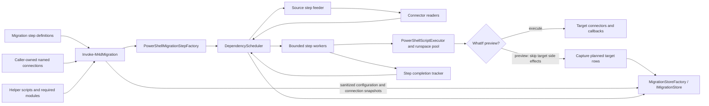
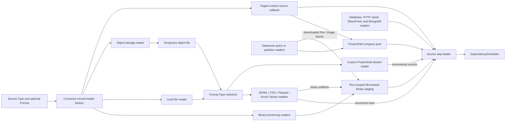
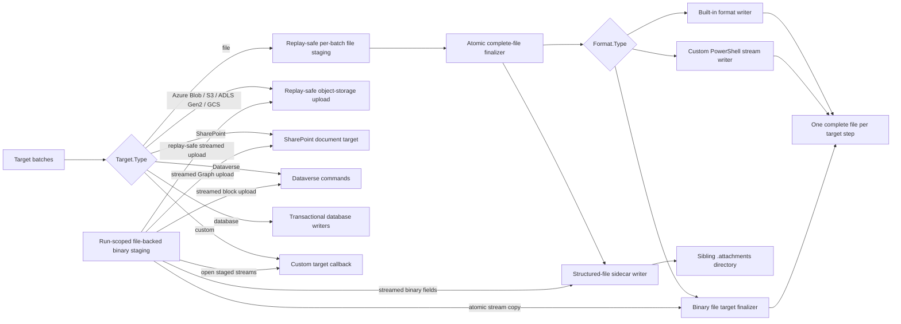
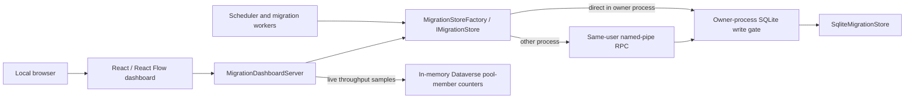
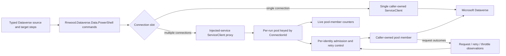
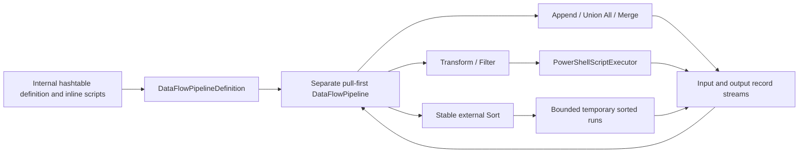
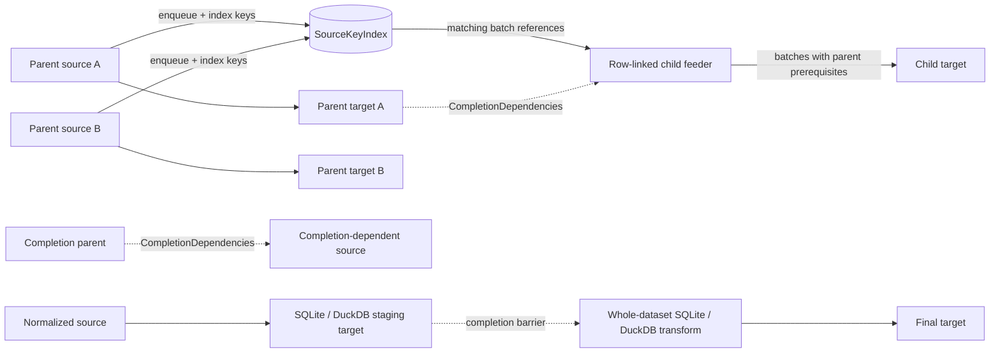
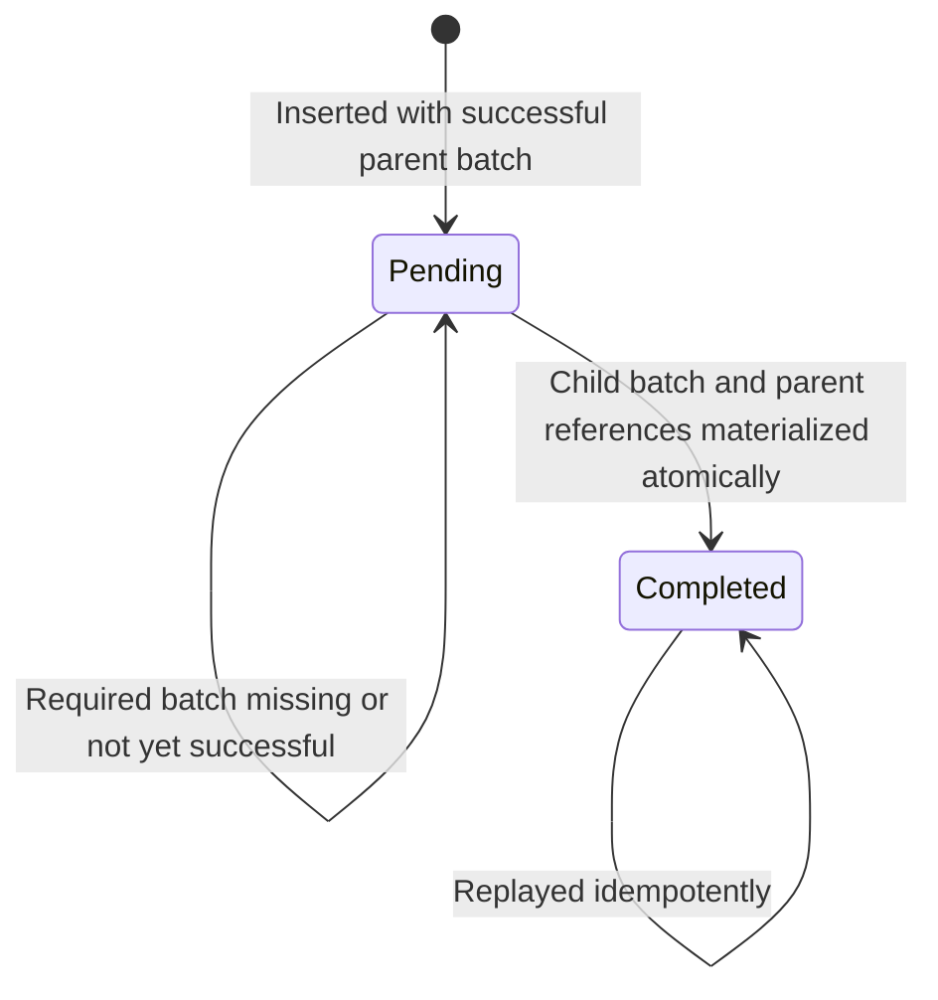

# Internal architecture and developer guide

This guide describes the current implementation, not a promise of complete KingswaySoft parity or a production-ready generic migration product. See the [feature plan](../../PLAN.md) for current scope and outstanding work.

> [!IMPORTANT]
> The C# types and scheduler contracts described here are internal implementation details, not a supported public API.

## System boundaries

The system boundaries are four binary PowerShell cmdlets, a local monitoring UI/API with constrained failed-batch recovery and continuation approval, a separate transformation API, and a local SQLite owner service:

1. **The binary PowerShell cmdlet** [`Invoke-M4dMigration`](../../src/Migration4Dataverse.Engine/PowerShell/InvokeMigrationCommand.cs) accepts a top-level `Steps` DAG. [`PowerShellMigrationStepFactory`](../../src/Migration4Dataverse.Engine/PowerShell/PowerShellMigrationStepFactory.Graph.cs) converts Source, Join, Transform, Filter, Append, Target, and callback nodes into [`MigrationStepDefinition`](../../src/Migration4Dataverse.Engine/Scheduling/MigrationStepDefinition.cs) objects for the shared [`DependencyScheduler`](../../src/Migration4Dataverse.Engine/Scheduling/DependencyScheduler.cs). Keyed source and join inputs declare their row-flow dependencies; `DependsOn` is reserved for additional whole-step completion barriers. A two-input Join stages and indexes inputs on disk, emits matches incrementally, then sends one nested row to a one-input Transform. Callback mode supports explicit multi-parent batch readiness through `MigrationDependencyOutput.RequiredBatchIds`.
2. **The data-flow API** in `Migration4Dataverse.Engine.Transformations` remains a separate named transformation DAG. PowerShell callers define it with hashtables and inline Transform and Filter script blocks; the engine internally binds those scripts to their node IDs. Its stream-wide Sort and Merge operators are not yet wired into `Invoke-M4dMigration`.
3. **The dashboard** [`MigrationDashboardServer`](../../src/Migration4Dataverse.Engine/Dashboard/MigrationDashboardServer.cs) hosts the built React/React Flow SPA and API over the same SQLite file. It binds only to a loopback URL; its same-origin POST mutations queue failed batches for replay, queue an edited retry for an exactly attributed row, or approve continuing downstream from one failed step. Basic run/step/batch metadata is always retained; row payload snapshots are opt-in except for `Invoke-M4dMigration -WhatIf`, which captures planned target inputs. While a run is active, it also reads in-memory per-member Dataverse pool counters for the live connection-throughput chart.
4. **The database owner** is hosted by the first caller that opens a database, or explicitly with `Start-M4dMigrationDatabaseServer`. It is the only Migration4Dataverse process that opens that SQLite file; other processes use same-user named-pipe IPC. Scheduler execution, workers, live connections, and callbacks remain in each caller process. A database can serve multiple active run IDs, with per-run leases preventing duplicate schedulers for the same run.
5. **Run history** is queryable through [`Get-M4dMigrationRun`](../../src/Migration4Dataverse.Engine/PowerShell/GetMigrationRunCommand.cs). The dashboard can also preview caller-supplied step and connection objects without starting a migration or opening a database.

### Invocation and scheduling



### Source ingestion and format selection



### Target writing and publication



### Persistence and monitoring



### Typed connectors and named connections

Each Source or Target step declares a storage/connector `Type` and `ConnectionId`. Local files use `Type = 'file'`; object-storage connectors use their provider type. Both select serialization independently through a top-level `Format` descriptor whose `Type` selects a built-in or PowerShell custom format and whose `Options` are format-specific. The caller supplies runtime objects in a map keyed by ID; secrets are not stored in step data. File and SQLite/DuckDB database connectors accept `DirectoryInfo` plus a relative step `Path` or a `FileInfo` naming the exact file. SQL Server, PostgreSQL, MySQL, and Oracle connectors accept caller-supplied ADO.NET `DbConnection` objects. Object-storage connectors accept Azure Blob, Amazon S3, ADLS Gen2, or Google Cloud Storage clients; HTTP sources and SharePoint targets accept an authenticated `HttpClient`; Salesforce, SharePoint, HubSpot, Zendesk, and ServiceNow sources also accept an authenticated `HttpClient`; MongoDB accepts an `IMongoClient` or `IMongoDatabase`. The engine creates and owns only SQLite/DuckDB connections and HTTP clients created from a URI, and it automatically registers the SQLite/DuckDB provider/native-library resolvers. Sources support JSONL, CSV, Parquet, Excel, binary and custom file formats, SQLite/DuckDB/SQL Server/PostgreSQL/MySQL/Oracle SQL queries, structured and binary Azure Blob/S3/ADLS Gen2/GCS objects, HTTP/OData, Salesforce, SharePoint list items and documents, HubSpot, Zendesk, ServiceNow, MongoDB documents, Dataverse queries, and paged PowerShell callbacks. Database query results stream from ADO.NET readers; binary file, object-storage, SharePoint, and Dataverse content streams directly into run-scoped staging. Structured object-storage sources stage each selected object to a temporary file before streaming records through the shared format reader; custom format callbacks consume that stream and emit records incrementally. Dataverse source queries use `Get-DataverseRecord` Simple/FetchXML modes or read-only Cds4Sql queries through `Invoke-DataverseSql`; results stream through the runspace pool with bounded buffering. Targets support Dataverse, file formats, SQLite, DuckDB, SQL Server, PostgreSQL, MySQL, Oracle, Azure Blob, S3, ADLS Gen2, GCS, SharePoint documents, MongoDB, and PowerShell callbacks. Custom format writers receive bounded batches and write directly to a stream, keeping whole-file buffering out of the callback contract. SQLite and DuckDB Transform nodes do not take caller connections; the factory creates and owns a run-and-step-specific database file for each provider/run/step under `.migration-transforms` beside the migration database. Their optional `InitializeSql` runs before any work is scheduled. Types and connection IDs may vary by step. There is not yet a general connector registry or plug-in API.

For a typed Dataverse source or target, a named connection slot can contain one module connection or an array of `ServiceClient` objects. A multi-connection slot creates one per-run pool shared by typed sources and targets that use that `ConnectionId`; the caller still owns the original connection objects. Pool construction verifies that connections target the same organization, uses `WhoAmI` to group the same effective user identity, and requires matching `MaxRetryCount` values. The pool wraps the upstream module's injected-service `ServiceClient` proxy so individual requests can be routed without changing the module's connection contract. It forwards Web API traffic through an exposed authenticated `WebApiHttpClient`, or, when the module lazily leaves that client unset, obtains bearer tokens and custom headers from the original connection's token-provider callbacks. Tokens are not persisted. Member retries are disabled while pooled so retry attempts pass through and are accounted by the proxy; original retry settings are restored when the step set is disposed.

#### Dataverse request routing



### Binary staging and recovery

Each `Invoke-M4dMigration` run derives a binary staging directory from the migration database path and run ID. Source readers and callbacks stream content into artifacts there; queued batch JSON stores only a versioned relative-path descriptor with file name, content type, representation, length, and SHA-256 metadata. Restoring a descriptor requires the artifact to remain inside the run directory and its stored length to match. Binary values therefore do not expand persisted batches, previews, or Join staging into Base64 payloads.

Mappings and custom callbacks receive a `MigrationBinaryValue` with stream readers and writers, staged Base64 encode/decode, JSON stream serialization, and MIME detection. Dataverse File/Image columns use block transfers; Notes and activity attachment bodies use the Dataverse record cmdlet's Base64 field contract at the target boundary. The source-side `FileColumns` option currently applies only to Simple queries. Filesystem binary targets accept exactly one record and publish atomically. Object-storage binary targets upload one mapped object key per record and use provider replay metadata; SharePoint document targets stream uploads and compare existing content on retry. Microsoft Graph's simple upload limits SharePoint files to 250 MiB; larger uploads require a custom callback using an upload session.

CSV, JSON Lines, and Parquet targets can externalize top-level binary columns as relative paths in a sibling `<target-file>.attachments/` tree. Finalization streams staged bytes to these sidecars before atomically publishing the structured data file, so an unsuccessful finalizer can leave unreferenced sidecar files while preserving the previous data file. Sources can opt in to resolving those fields back into `MigrationBinaryValue` objects; the default resolver confines paths to the source file's parent directory. This format deliberately has no manifest, so the data file and sidecar tree must be moved together and MIME metadata is inferred when read.

Staging artifacts are removed after a successful non-preview run. Failed or cancelled runs retain them so pending batches can be resumed. Since artifacts live beside the migration database, a resume must have access to the same filesystem location; moving only the SQLite database to another machine is insufficient. WhatIf preview artifacts are retained with the preview snapshots. Sidecar output directories are separate durable target files and are not removed with run staging; old run-specific directories may be cleaned up only after confirming that no structured file references them.

Each identity receives a concurrency limit from its connection's `RecommendedDegreesOfParallelism` (falling back to 4). Connections reporting the same identity share that limit. The pool admits requests only for identities below their active-request limits, preferring the least-used identity in a rolling five-minute request-unit window and then the least-used connection within that identity. It waits when all identities are at capacity. The pool expands nested `ExecuteMultiple` and `ExecuteTransaction` operations, charges recognized `*Multiple` requests by target count, and counts retries as distinct attempts. It does not hard-code a universal request quota or adapt concurrency based on throughput. Retry and throttle telemetry is diagnostic only. A single-connection slot retains the direct-connection path; its Dataverse targets use the connection recommendation as their concurrency budget.

Root Dataverse sources may define explicit query partitions. The factory creates one streaming reader per partition, bounded by the PowerShell runspace limit, and merges their sorted rows by the source key. The merged reader rejects duplicate or out-of-order keys and stores a separate resume key for each stable partition ID. On resume, partition queries replay to their individual cursors; callers must keep partition IDs and query behavior stable and define a complete, non-overlapping partition set. The engine cannot prove that a partition set has no gaps.

Targets sharing a Dataverse connection ID share a fixed connection-budget controller. The controller caps target batches by the connection or pool recommendation and `MaxDegreeOfParallelism`; a target's numeric `MaxConcurrency` can impose a smaller limit. Multi-connection pools additionally gate individual service calls per identity, including calls from Dataverse sources. File connectors resolve `Path` relative to a `DirectoryInfo`, or use `FileInfo.FullName` directly when `Path` is omitted. JSONL, CSV, and Parquet targets stage replay-safe batch files beside the destination, then combine them in sequence into exactly one destination file after the graph succeeds. CSV emits one header; Parquet is rewritten with bounded row groups. Excel is source-only. A temporary file and atomic replacement preserve any previous destination when a run fails before publication. Object-storage targets use the same staged single-file path, then upload one complete object with a SHA-256 replay metadata value; an existing object is accepted only when its metadata matches. SQL database targets serialize batches per connection and use a transactional replay marker; MongoDB targets use a `_m4d_batch_ledger` collection for the same purpose. Finalization runs before the scheduler records `Completed`, so a finalizer error marks the run failed. Custom callbacks receive the caller's connection object; custom targets must implement their own replay-safe write behavior.

SQLite and DuckDB Sources and Targets take database file paths through `-Connections`, not caller-created ADO.NET objects; the engine creates/disposes their connections and loads the required provider automatically. SQL Server, PostgreSQL, MySQL, and Oracle Sources and Targets take caller-supplied ADO.NET connections; the engine opens and closes them as needed, serializes target batches per connection, and never disposes the caller's object. A database `DirectoryInfo` requires a step `Path` naming the database file. Database source steps issue `Options.Query`, and database targets write records to `Table`. DuckDB, SQL Server, PostgreSQL, MySQL, and Oracle targets create missing tables by default; SQLite targets require an explicit schema and key, validate existing columns and declared indexes by default, and only create missing objects when `CreateTable = $true`; they never alter or drop existing objects. SQLite, SQL Server, PostgreSQL, MySQL, and Oracle writes use their provider-specific key behavior, and each batch's writes and run/step/batch content hash marker commit in one transaction after any provider DDL has completed; MySQL and Oracle may implicitly commit table creation first, so identical scheduler retries are idempotent once target objects exist. SQLite source reads bind named parameters and enforce read-only query execution; the other providers bind named parameters according to their placeholder syntax. Database transforms use an engine-owned connection gated across their executions. A whole-dataset SQLite or DuckDB staging Target shares that transform's managed database; its schema is prepared before workers start and its query reader begins after the staging barrier completes.

Dataverse queries rerun from the beginning when resuming; the source reader replays records through the last completed source cursor. Partitioned Dataverse sources retain one resume key per partition in addition to the merged source cursor. Simple queries automatically order by `Source.Key` unless an `OrderBy` is supplied with ascending `Key` first. FetchXML, SQL, and custom readers should provide a stable ascending `Key` order. Root source keys must be unique and strictly increasing using case-insensitive ordinal comparison for Dataverse sources, matching platform collation; other root sources use ordinal comparison. Row-linked child sources are staged internally and need not be grouped by parent. Child keys must be unique within each non-null parent relationship.

[`PowerShellScriptExecutor`](../../src/Migration4Dataverse.Engine/PowerShell/PowerShellScriptExecutor.cs) imports requested modules into a runspace pool, makes configured helper scripts available to each invocation, executes scripts asynchronously with cancellation, and raises `PowerShellScriptException` when PowerShell reports errors. `-RequiredModules` resolves installed PowerShell module specifications and enforces requested version constraints; their resolved versions and helper script contents participate in the default resume hash. Its bounded streaming output path allows Dataverse source results to be batched without buffering the full query. Migration step handlers execute Transform/Filter scripts and dispatch Target batches to the selected connector; custom connector modules are imported into the pool so callbacks can use their dependencies from runspaces.

When a Join references Dataverse Target steps, those Targets appear as the right-hand row-flow input. Producers persist each required input row and configured join-key projection to run-scoped SQLite staging as their batches complete; Target rows include the final GUID returned by `Set-DataverseRecord -PassThru`. The indexed reader processes left rows in their stable sequence and probes the durable parent-key index as parent rows become available. Matches are emitted before either side completes; non-null unmatched keys are resolved only after the right-hand step completes, while null or blank keys never match. `inner` filters unmatched rows; `left` retains them with the parent alias set to `$null`. A Join may also use a Source as its parent input. For whole-job sequencing, that Source can declare `DependsOn` on the terminal Target and reread its completed rows from Dataverse; the Join then incurs those additional reads instead of consuming Target output rows. Chained two-input joins support additional lookups and dotted child-key paths into a nested left row. Input ordering is not required; SQLite staging is removed after success and retained after failure for run recovery.

The other migration paths remain bounded by batch or row: connector readers yield batches, Transform and Filter invoke scripts per row unless SQLite/DuckDB set-based SQL mode is selected, Append processes its input streams sequentially, and target handlers process one batch at a time. Per-batch SQL stages only the current batch in a temporary table and carries explicit lineage indexes. Whole-dataset SQL waits for a matching SQLite/DuckDB staging Target to finish, then streams a read-only query over the shared managed database; the input Target acts as a completion barrier, not a batch-payload source. File targets use durable replay-safe per-batch staging but do not expose intermediate batch files as final output. Standalone Merge uses one-row lookahead per input. Standalone Sort uses bounded in-memory runs and temporary disk spill; no operator-wide in-memory row collection is used.

Database-backed migration Transform nodes can be per-row: SQLite invokes its PowerShell `Script` with the row and managed connection, while DuckDB can invoke the same script contract or run a prepared SQL statement using positional parameters. Both providers also support per-batch SQL against a temporary input table and whole-dataset reads after an explicit matching staging Target completion dependency. `InitializeSql` runs during graph creation, before any batches, and should be idempotent for resume. Set-based SQL modes require a read-only SELECT/WITH query and stream their results with lineage. Managed database filenames include safe step and run segments plus a full identity hash, are stable for resume, and do not share connections with configured sources or targets.

### Data-flow transformations

[`DataFlowPipelineDefinition`](../../src/Migration4Dataverse.Engine/Transformations/DataFlowPipelineDefinition.cs) validates a named acyclic graph, and [`DataFlowPipeline`](../../src/Migration4Dataverse.Engine/Transformations/DataFlowPipeline.cs) executes it pull-first. PowerShell consumers author configuration as hashtables and place scripts inline in each Transform or Filter node's `Script` property; the pipeline API extracts them into its internal node-ID map. Append/Union All and Merge stream records; Merge keeps one-row lookahead per side and validates the configured ordering. Transform can emit zero or more JSON objects per input row, while Filter uses script output truthiness to keep or discard the original row. Sort is stable and external: it writes bounded sorted runs and performs pairwise merge passes under the configured memory, row, record-size, and spill limits.



The migration graph supports multiple consumers and Source, Append/Union All, Join, Target, Transform, Filter, and callback nodes. Stream-wide Sort and Merge belong to the separate internal data-flow pipeline; graph Join is a separate keyed row-combination step and does not redefine Merge. See the [internal transformation reference](./transformations/README.md) for its schema and operator details.

## Scheduler contracts

The internal scheduler contracts are in the [scheduling source folder](../../src/Migration4Dataverse.Engine/Scheduling/):

- A `MigrationStepDefinition` has a unique ID, node type, declared input step IDs, an optional source callback, and a batch handler. A reader may identify a root source or a streaming Join reader.
- Join reads persisted input rows incrementally and may emit matches before the producers finish. Its default `JoinOrder = 'ready'` defers unavailable child keys and emits later ready matches without preserving left-input order; `JoinOrder = 'stable'` preserves that order and can wait behind an unavailable key. Unmatched keys resolve when the parent finishes. The SQLite or DuckDB whole-dataset Transform is the other source-driven exception: it requires a matching SQLite or DuckDB staging Target whose managed database it shares, and it waits for that target's completion before opening its query reader. Other source-driven steps continue to require source-driven inputs.
- `CompletionDependencies` is a separate all-of barrier. Source feeders wait before reading; row-linked dependency events also wait before materialization. A dependency step completes only after its upstream steps finish and its own batches and incoming dependency events drain.
- The scheduler validates step IDs and input references and rejects invalid graphs such as cycles or a graph without a root reader.
- A root callback receives its `MigrationStepCheckpoint` and a cancellation token, then streams `MigrationWorkBatch` values. Each batch carries JSON payload and optional cursor-after JSON. Root sources should be incremental and replayable rather than buffering an entire table.
- A handler receives a leased `StoredBatch` and returns a `MigrationBatchResult` containing JSON outcomes, an error flag, and optional `MigrationDependencyOutput` values.
- Each dependency output names a declared child step and contains JSON payload. `RequiredBatchIds` can add explicit prerequisites for multi-parent work. Every prerequisite must belong to this run, be a declared input of the child, and succeed before the child batch is released.
- The scheduler creates batch identities from run, step, and sequence. Replaying an existing identity requires the same durable payload and cursor; a different definition uses a different run ID and step hash.

`Inputs` declares which steps can publish dependency work; it does not implicitly join all batches from all inputs. For a multi-parent gate, the producer must provide the required batch IDs in the dependency output. That gate does not itself join or transform records.

The PowerShell graph's `Inputs` declares row flow and implicitly declares dependencies. A keyed source input uses `Job` and `Keys = @{ Child = ...; Parent = ... }` to link a child source to a parent source; the parent name must equal the parent's `Source.Key`. A row with a null key for one parent is retained without waiting on that relationship, while its other non-null relationships still wait for matching parent batches. A non-null key with no matching parent fails the run. `RowsPerParent` can enforce fixed fan-out independently for each relationship; omitted or zero means variable fan-out, including parents with no children. `DependsOn` accepts only additional step IDs used as completion barriers. Row-linked sources are staged internally, so their input need not be grouped by foreign key.



## Scheduler lifecycle

[`DependencyScheduler.ExecuteAsync`](../../src/Migration4Dataverse.Engine/Scheduling/DependencyScheduler.cs) validates the graph and options, creates or verifies the run against its name and step hash, and acquires an exclusive lease for that run ID. Distinct run IDs can execute concurrently against one database through its owner process. The scheduler then starts root feeders, the worker pool, a dependency-event pump, and a per-run lease heartbeat concurrently.

Root feeder exceptions retry from the latest durable enqueue cursor up to `SourceReadMaxAttempts` (default 3) with exponential delay starting at two seconds and capped at one minute; cancellation is not retried. Batch-handler exceptions retry up to `MaxAttempts` (default 5) with the scheduler retry delay. A handler's explicit `HasErrors` result is terminal rather than retryable. By default, any row errors fail the run; an invocation-wide or per-step percentage threshold can accept row errors. Exhausted reader, handler, and infrastructure failures remain fatal unless an operator explicitly approves continuing past the affected step. Committed batches and external side effects are not rolled back.

```mermaid
sequenceDiagram
    autonumber
    participant Caller
    participant Scheduler
    participant Root as Source feeder
    participant Keys as Source-key coordinator
    participant Completion as Step completion tracker
    participant Store as SQLite store
    participant Workers as Bounded workers
    participant Gate as Target permit / queue budget
    participant Handler as Batch handler
    participant Pump as Dependency event pump
    participant Join as Indexed Join reader

    Caller->>Scheduler: ExecuteAsync(run, hash, steps, options)
    Scheduler->>Store: CreateRun and acquire run-scoped scheduler lease
    Scheduler->>Store: Read progress and step checkpoints

    par Source feeders
        Scheduler->>Completion: Await DependsOn parents before reading
        Completion-->>Scheduler: Parent steps drained
        Scheduler->>Store: Read completed checkpoint and latest enqueued cursor
        Store-->>Scheduler: Completed checkpoint + durable resume position
        Scheduler->>Root: ReadSourceBatches(resume checkpoint, token)
        Root-->>Scheduler: Work batch and cursor
        Scheduler->>Store: Enqueue payload and source-key index
        Root->>Keys: Signal parent source completion
        Keys-->>Root: Release waiting key requests or fail unmatched keys
        Note over Scheduler,Root: Source exceptions retry from the latest durable cursor, except cancellation
    and Worker pool
        Workers->>Gate: Try acquire target execution permit
        Gate-->>Workers: Permit or unavailable
        Workers->>Scheduler: Reserve downstream queue capacity
        Workers->>Store: TryLeaseNextBatch
        Store-->>Workers: Leased batch
        Workers->>Handler: Execute batch
        Handler-->>Workers: Outcomes and dependency outputs
        Workers->>Store: CompleteBatch with outputs and checkpoint
        Workers->>Scheduler: Release producer reservation and execution permit
    and Dependency event pump
        Pump->>Store: Read pending events by keyset page
        Pump->>Completion: Check child completion dependencies
        Completion-->>Pump: Ready or still waiting
        Pump->>Scheduler: Reserve one child batch slot
        Pump->>Store: TryMaterializeDependencyEvent
        Store-->>Pump: Child batch when prerequisites succeeded
    end

    alt Terminal failure or cancellation
        Scheduler->>Store: Persist run failure context and terminal status
        Scheduler-->>Caller: Surface run failure
    else Successful drain
        Scheduler->>Scheduler: Run completion hooks and atomically publish file targets
        Scheduler->>Store: Mark run completed and release run lease
    end

    Note over Store,Keys: Batch enqueue and source-key indexing are transactional.
    Note over Store,Pump: Dependency-event inserts and checkpoint advancement are transactional.
    Note over Store,Workers: Batch leasing acquires the WAL writer slot before selecting a batch; other read-modify-write operations serialize before reading, while WAL readers remain concurrent.
    Note over Caller,Store: IMigrationStore is a local call when the caller owns the database, otherwise a same-user named-pipe request to its single SQLite owner.
    Note over Store: The owner centralizes SQLite connections and write serialization; it does not host schedulers, workers, callbacks, or live connector objects.
    Join->>Store: Scan completed left rows and restore deferred row cursors
    Join->>Store: Probe successful parent rows by durable key index
    Store-->>Join: Matching parent rows from completed batches
    Join-->>Scheduler: Emit ready matches incrementally (default; may reorder)
    Join->>Completion: Resolve deferred keys when the parent finishes
    Note over Join,Store: JoinOrder = stable waits at each left row and preserves input order.
    Workers->>Store: Lease and execute materialized child batches
```

### Sources, workers, and backpressure

- Before creating run metadata, the scheduler resolves supported source counts once. SQLite, DuckDB, PostgreSQL, MySQL, and Oracle wrap the main `Query` in a scalar count query unless an explicit `CountQuery` override is supplied; SQL Server requires an explicit `CountQuery` for this provider; MongoDB uses `CountDocumentsAsync`; Simple and FetchXML Dataverse sources use `Get-DataverseRecord -RecordCount`; custom sources can invoke a `CountCallback`; Parquet sources read row counts from file metadata; Excel sources read the selected sheet; Salesforce uses `SELECT COUNT()` unless custom `Soql` is set; HubSpot uses the search total when search is used; and Zendesk uses the search count when `Query` is set. Cds4Sql, CSV, JSONL, object-storage, HTTP/OData, SharePoint, and ServiceNow sources do not scan their contents to calculate a total; without an explicit `ExpectedRecordCount`, their totals become known as rows flow. Positive explicit or resolved counts are checked against the source rows when enumeration completes, including an expected total of zero.
- Each root feeder preserves the last contiguous completed sequence and cursor, and separately resumes source enumeration after the latest durably enqueued batch. Pending and in-flight batches remain authoritative in SQLite and are processed from their stored payloads; the feeder does not regenerate them. Every new JSON batch is durably enqueued before a worker can write it.
- A non-cancellation source-reader exception retries from the latest durable enqueue position, up to `SourceReadMaxAttempts` (default 3). The exponential delay starts at `SourceReadRetryDelaySeconds` (default 2) and caps at one minute. After exhaustion, the scheduler records a run-level failure even if no batch was created. Batch-handler exceptions retry up to `MaxAttempts` (default 5); a handler result with `HasErrors` is terminal without another scheduler retry.
- `MaxErrorRatePercent` (default 0) and per-step `ErrorRateThresholdPercent` accept a cumulative failed-row rate calculated from succeeded plus failed rows for that step. The store evaluates the rate and persists batch completion, acceptance, and emitted dependency events in one transaction. Accepted row-error batches remain visible and cause final run status `CompletedWithErrors`; downstream can materialize only dependency output explicitly emitted by that handler. A per-step override can instead let the scheduler proceed past unaccepted failed batches or a source-reader failure. On resume, it does not replay the failed batch or restart an approved failed source feeder; it drains persisted work and routes only already-emitted outputs. Unread source rows remain skipped.
- An unaccepted row error or a fatal reader/handler/infrastructure error stops the run, including independent graph branches. Dependency children whose prerequisites are not successful, accepted, or explicitly continued remain blocked. Previously committed batch state and external effects are not rolled back; callers must reconcile possible side effects before replay or continuation.
- A root source with completion dependencies waits for every referenced step to drain before opening its source reader. Completion is derived recursively from upstream completion, in-flight batches, and pending incoming dependency events; parent failures fail the run.
- A row-linked source has its own source feeder and stages its rows in a temporary SQLite database. Each keyed `Inputs` entry identifies a parent Source and maps the child `Child` property to that parent's `Source.Key` through `Keys.Parent`. The feeder releases null-containing rows first (without a batch prerequisite for null relationships), then linked rows as all matching parent batches become available. If the child source has explicitly declared completion barriers, the feeder waits for those steps before reading.

Join readers stage both input streams in SQLite and use a durable key index for parent lookups. In the default ready mode, the reader advances through completed child rows, retaining positions for keys not yet present in the parent index while emitting available matches; those outputs may be out of left-input order. The checkpoint stores the scan position and deferred row references, so a restart can continue resolving them. Once the parent completes, remaining keys become unmatched left rows or filtered inner rows. Stable mode instead waits on each child row in sequence before advancing.
- Row-linked sources support either a positive fixed `RowsPerParent` count per relationship or variable fan-out when the setting is omitted or zero. Each non-null key must match a parent key; missing matches fail. Explicit JSON null represents an absent relationship, while missing or blank key properties are invalid. Rows with all relationships null have no parent-batch prerequisites. Input need not be grouped or ordered by foreign key; staging sorts by null status, parent-key tuple, and child key.
- `MaxQueuedBatches` (default 64) bounds pending plus in-flight batches, while `MaxQueuedBatchesPerStep` (default 32) bounds each step's outstanding batches and producer reservations. Producers reserve downstream capacity before leasing work; the dependency pump incrementally materializes multi-batch fan-out only when a child slot is available, skipping full consumers instead of blocking sibling branches. Durable, prerequisite-blocked dependency events do not consume materialized-batch capacity.
- The SQLite owner is the only Migration4Dataverse process that opens its database. Caller-side `IMigrationStore` clients use an in-process implementation when local, or a same-user named-pipe request when remote. The owner maintains a bounded pool of eight reusable pipe listeners; each listener handles one request at a time, avoiding concurrent listener recreation while still serving multiple requests concurrently. Inside the owner, WAL supports concurrent readers and a per-database write gate serializes mutations because SQLite permits only one writer at a time. Selected lease and worker persistence operations retain bounded `BUSY`/`LOCKED` retries with exponential backoff and jitter for contention outside that gate; unrelated SQLite errors remain visible and fail the run. The owner lock is released automatically when its process exits, so clients can reconnect by reopening the store after a crash; an in-progress caller must be restarted to resume its run.
- Root feeders use their own bounded share of the global batch queue and do not wait on ready dependency events across the whole graph; worker-level dependency priority preserves prompt child execution without pausing unrelated roots.
- `MaxDegreeOfParallelism` controls the number of workers and has no fixed engine ceiling. SQLite work remains shared, while handlers execute concurrently up to this bound; Dataverse connection budgets, custom-target semaphores, and available system resources may further limit concurrent writes.
- Ready materialized dependency batches are prioritized over queued root batches, allowing child work to start after its parent batch succeeds rather than waiting for the root source to finish. Within each dependency-priority group, a weighted-fair dispatcher combines graph-derived pipeline impact with the current ready-batch backlog. More impactful, backlogged work gets more dispatches, while service counts and rotation ensure lower-weight ready steps are not starved. Workers acquire target execution permits and downstream queue capacity before leasing batches.
- Dependency events are read in keyset pages ordered by `(CreatedUtc, EventId)`. A pending event whose prerequisites are not complete remains pending; the pump continues looking for later events so a blocked earlier event does not starve ready work.
- The run completes only after root feeders finish and there are no outstanding non-terminal batches or pending dependency events.

A `PipelineThroughputMeter` records successful target rows for dashboard throughput; it no longer selects batch sizes or concurrency. Dataverse target batch size defaults to 10 independently of `Invoke-M4dMigration -BatchSize`; an explicit target `BatchSize` can override it up to 1,000. A `PipelineDataverseConnectionController` applies a fixed per-connection target budget: the connection's recommendation, or the sum of unique identity recommendations for a pool, is capped by the invocation's `MaxDegreeOfParallelism`. A numeric target `MaxConcurrency` can apply a smaller per-target cap. The pool separately gates individual requests by identity and waits when all identity budgets are full. The retry monitor temporarily enables in-memory ServiceClient logging, counts retry/throttle signals without storing raw entries, and restores the original logging setting; telemetry does not alter budgets. Normal retries remain enabled. Diagnostic `-DataverseNoRetryDiagnosticMode` disables ServiceClient, cmdlet, and scheduler retries for the run, restoring the connection's original retry setting when disposed.

Automatic batch-size and DOP tuning have been removed. Saved tuning profiles from earlier versions are not read or written by current runs; `Clear-M4dMigrationTargetTuning` remains available to remove legacy values. The scheduler worker limit remains global, so a target-level limit cannot increase total scheduler parallelism. `Set-DataverseRecord` runs with internal parallelism one. Target `Options.MatchOn` selects alternate-key match behavior without `-Upsert`, which the connector module does not support together with `-MatchOn`; `Options.LookupColumns` resolves scalar lookup values against referenced-table key fields. A Join's parent key pairs must match an ordered `MatchOn` key group; staged Target rows contain mapped fields plus the final GUID in `Id`. Its indexed reader emits matches from successful parent batches without waiting for the full parent step; only unmatched non-null keys wait for parent completion. The caller is responsible for creating and owning target connections. General C# callers may configure handler concurrency according to their handler and connection-pool design.

### Batch completion, retries, and cancellation

A worker leases one batch, incrementing its attempt count, and renews that batch lease while its handler is running. A successful handler result is committed with `CompleteBatch`. A handler exception is retried up to `MaxAttempts` with exponential delay capped at one minute; before retrying, the batch is returned to `Pending`. Invalid handler results and exhausted retries are recorded as terminal failures. A result with row errors is recorded as `CompletedWithErrors`; it fails the run unless the configured per-step threshold accepts those errors.

Successful completion atomically records outcomes, releases the batch lease, inserts dependency events, advances the table checkpoint, and removes the now-unneeded payload JSON. Outcomes may include optional step-specific specialist information; Dataverse targets record their fixed batch size, effective concurrency cap, and retry/throttle telemetry for the dashboard. A batch with row errors retains its payload and error outcomes. Its exact row errors and original row JSON are stored in `BatchRowErrors` when the handler reports reliable input indices; its dependency outputs stay held until errors are accepted by policy or resolved through retries. The dashboard can create a single-record batch at the same Transform, Filter, or callback step with an edited payload, while preserving the original row's lineage. Successful resolution follows `BatchRowRetryLinks` back through the retry chain and marks the original failed batches successful when all their row errors are resolved. Unattributed errors remain batch-level and require batch replay or step continuation. Resumption is blocked until unaccepted failures have been reviewed and an eligible recovery action queued; the dashboard preserves batch replay outcomes in retry history.

When cancellation interrupts handler execution, the scheduler abandons the batch back to `Pending` before stopping. If another worker has already reclaimed a batch, the former owner cannot complete or abandon it; its stale outcome is discarded and the current lease owner controls the durable transition. Losing a batch lease alone does not fail the run. Persisted work can be resumed by reusing the same run ID and unchanged step definition after the run lease is available.

## SQLite persistence and recovery

[`SqliteMigrationStore`](../../src/Migration4Dataverse.Engine/Storage/SqliteJobStore.cs) requires a file-backed database. It enables WAL journal mode and configures foreign keys, `synchronous = FULL`, and a 30-second busy timeout. Scheduler read-modify-write operations begin immediate transactions so concurrent workers reserve SQLite's single WAL writer slot before reading, avoiding deferred-transaction upgrade races while allowing readers to continue. A per-run lease prevents duplicate schedulers for the same run while allowing other run IDs to use the same database concurrently. The write gate records wait and hold durations through the `Migration4Dataverse.Engine.Storage` meter.

Ordered migrations are tracked in `SchemaMigrations` by version, name, and applied time; each migration and its ledger row commit in one transaction. Migration 1 creates the initial store. Migration 2 renames job/table identifiers to run/step identifiers while preserving their row data. Migration 3 adds persisted step runtime metrics and per-batch row totals. Migration 4 adds the legacy target-record ID mapping table. Migration 5 adds the legacy Target context table. Migration 6 adds Join input and match staging plus explicit batch-parent references. Migration 7 adds nullable per-batch input-row counts and filtered-row counts; uncountable callback payloads stay `NULL`, not zero. New batches are counted when queued, and successful completion may remove the original payload without losing the count. Migration 8 records step activity intervals for working-versus-waiting timelines; it does not reconstruct intervals for runs created before this migration. Migration 9 adds `SourceKeyIndex`, a durable mapping from each keyed source row to its queued batch and record index, written transactionally with batch enqueue. Migration 10 adds `JoinInputKeyIndex` for indexed streaming-join key lookups. Migration 11 adds an index that lets debug-snapshot retention cleanup seek by run and capture time. Migrations 12–14 add the legacy `DataverseTargetTuningProfiles` table and its metadata. Migration 15 adds persisted run-level failure details and `BatchRetryHistory` for retaining prior batch errors and outcomes when failed batches are queued for replay. Migration 16 adds the batch `FailureAccepted` flag and per-run `StepFailureContinuations` table, and rebuilds `Runs` to permit the `CompletedWithErrors` status. Migration 17 adds `BatchRowErrors` for exact row attribution and `BatchRowRetryLinks` for tracking edited, single-row retry chains. Current runs ignore legacy tuning values; `Clear-M4dMigrationTargetTuning` removes one or all legacy profiles.

Untracked legacy databases are rejected; create a fresh database when upgrading from a build that predates the migration ledger.

Dashboard input progress sums persisted `InputRows` by batch state and reports filtered rows separately. Root source totals may use a resolved source count provider or the positive configured `ExpectedRecordCount`; finalized step totals are derived after every upstream input has completed and pending dependency events are materialized. While a step is still receiving input, the dashboard recursively projects its total from upstream projected outputs and observed input/output ratios; if source totals are unknown or an upstream branch cannot be projected, it falls back to progress among currently materialized batches. The global target bar and ETA use projected target-write totals and observed target output throughput when available, and remain explicitly approximate until final counts are known.

```mermaid
erDiagram
    RUNS ||--o{ BATCHES : contains
    RUNS ||--o{ BATCH_RETRY_HISTORY : records
    BATCHES ||--o{ BATCH_RETRY_HISTORY : preserves
    BATCHES ||--o{ BATCH_ROW_ERRORS : attributes
    BATCHES ||--o{ BATCH_ROW_RETRY_LINKS : retries
    BATCH_ROW_ERRORS ||--o{ BATCH_ROW_RETRY_LINKS : links
    RUNS ||--o{ STEP_CHECKPOINTS : tracks
    STEP_ACTIVITY ||--o{ STEP_ACTIVITY_PERIODS : records
    RUNS ||--o{ SOURCE_FEEDERS : tracks
    RUNS ||--o{ DEPENDENCY_EVENTS : owns
    BATCHES ||--o{ DEPENDENCY_EVENTS : publishes
    RUNS ||--o{ DEBUG_SNAPSHOTS : retains
    BATCHES ||--o{ DEBUG_SNAPSHOTS : describes
    RUNS ||--o{ DEBUG_BATCH_INPUTS : indexes
    BATCHES ||--o{ DEBUG_BATCH_INPUTS : indexes
    RUNS ||--o{ TARGET_RECORD_IDS : maps
    RUNS ||--o{ TARGET_RECORD_CONTEXTS : indexes
    RUNS ||--o{ JOIN_INPUT_RECORDS : stages
    JOIN_INPUT_RECORDS ||--o| JOIN_INPUT_KEY_INDEX : keys
    RUNS ||--o{ JOIN_INPUT_KEY_INDEX : indexes
    RUNS ||--o{ JOIN_RELATIONSHIP_MATCHES : stages
    RUNS ||--o{ SOURCE_KEY_INDEX : indexes
    BATCHES ||--o{ BATCH_PARENT_REFERENCES : references
    BATCHES ||--o{ SOURCE_KEY_INDEX : contains

    RUNS {
        string RunId PK
        string RunName
        string StepHash
        string Status
        string SchedulerLeaseOwner
        string SchedulerLeaseExpiresUtc
        string FailureJson
        string PipelineJson
        boolean DebugCaptureEnabled
        integer DebugCaptureRetentionDays
        string FinishedUtc
        string ConfigurationJson
        string ConnectionInstancesJson
    }

    STEP_CHECKPOINTS {
        string RunId PK
        string StepId PK
        integer LastCompletedSequence
        string CursorJson
        string UpdatedUtc
    }

    SOURCE_FEEDERS {
        string RunId PK
        string StepId PK
        boolean Completed
        string UpdatedUtc
    }

    BATCHES {
        string BatchId PK
        string RunId FK
        string StepId
        integer Sequence
        string PayloadHash
        string PayloadJson
        string State
        integer Attempts
        string LeaseOwner
        string LeaseExpiresUtc
        string OutcomesJson
        integer SucceededRows
        integer FailedRows
        integer InputRows
        integer FilteredRows
        string LastError
    }

    BATCH_RETRY_HISTORY {
        integer RetryId PK
        string RunId FK
        string BatchId FK
        string StepId
        integer PreviousAttempts
        string PreviousLastError
        string PreviousOutcomesJson
        string QueuedUtc
    }

    BATCH_ROW_ERRORS {
        string RunId PK
        string BatchId PK
        integer RecordIndex PK
        string Error
        string PayloadJson
        string ResolvedUtc
        string RetryBatchId
        integer RetryCount
    }

    BATCH_ROW_RETRY_LINKS {
        string RunId
        string RetryBatchId PK
        string ParentBatchId
        integer ParentRecordIndex
    }

    STEP_ACTIVITY {
        string RunId PK
        string StepId PK
        string StartedUtc
        integer ActiveMilliseconds
        integer IdleMilliseconds
        integer ActiveCount
        string ActiveSinceUtc
        string IdleSinceUtc
        string CompletedUtc
    }

    STEP_ACTIVITY_PERIODS {
        integer PeriodId PK
        string RunId FK
        string StepId FK
        string State
        string StartedUtc
        string EndedUtc
    }

    DEPENDENCY_EVENTS {
        string EventId PK
        string RunId FK
        string ParentBatchId FK
        string ChildStepId
        string PayloadJson
        string PrerequisiteBatchIdsJson
        string State
    }

    DEBUG_SNAPSHOTS {
        integer SnapshotId PK
        string RunId FK
        string BatchId FK
        string StepId
        string StageName
        integer RecordIndex
        integer Attempt
        string LineageId
        string ParentLineageIdsJson
        string PayloadJson
        string CapturedUtc
    }

    DEBUG_BATCH_INPUTS {
        string RunId FK
        string BatchId FK
        integer RecordIndex
        string LineageId
    }

    TARGET_RECORD_IDS {
        string RunId PK, FK
        string ConnectionId PK
        string TableName PK
        string KeyColumn PK
        string KeyValue PK
        string RecordId
        string UpdatedUtc
    }

    TARGET_RECORD_CONTEXTS {
        string RunId PK, FK
        string StepId PK
        string ConnectionId PK
        string TableName PK
        string KeyColumn PK
        string KeyValue PK
        string RecordJson
    }

    JOIN_INPUT_RECORDS {
        string RunId PK, FK
        string JoinStepId PK
        string InputStepId PK
        integer Sequence PK
        integer RecordIndex PK
        string RecordJson
        string OriginBatchId
        integer OriginRecordIndex
    }

    JOIN_INPUT_KEY_INDEX {
        string RunId PK, FK
        string JoinStepId PK
        string InputStepId PK
        integer Sequence PK
        integer RecordIndex PK
        string KeyJson
    }

    JOIN_RELATIONSHIP_MATCHES {
        string RunId PK, FK
        string JoinStepId PK
        integer Sequence PK
        integer RecordIndex PK
        string Alias PK
        string ParentInputStepId
        integer ParentSequence
        integer ParentRecordIndex
    }

    BATCH_PARENT_REFERENCES {
        string RunId PK, FK
        string BatchId PK, FK
        string ParentBatchId PK, FK
    }

    SOURCE_KEY_INDEX {
        string RunId PK, FK
        string StepId PK
        string SourceKey PK
        string BatchId FK
        integer RecordIndex
    }
```



The prerequisite batch IDs are stored as JSON in the dependency event rather than as foreign-key rows. `ParentBatchId` is a relational reference to the batch that emitted the event. Migration 002 renamed stored run, step, batch, checkpoint, dependency-event, and debug-snapshot columns while retaining their values; migration 003 added persisted step runtime accounting and per-batch row totals; migration 004 added target-record ID mappings. See [SQLite persistence and recovery](#sqlite-persistence-and-recovery) for the complete migration history through migration 016, including `JoinInputKeyIndex`, legacy tuning-profile tables, run-level failures, retry history, and error continuation policy.

| Store | Purpose |
| --- | --- |
| `Runs` | Run name/hash, run status, scheduler lease owner/expiry, and serialized terminal failure context. Reusing a run ID with a different run name or hash is rejected. |
| `Runs.PipelineJson` | Snapshot of step IDs, types, row-flow input IDs, completion dependencies, and source-backed status for monitoring; retained even when debug capture is disabled. |
| `Runs.ConfigurationJson` | Safe projection of the original PowerShell steps and named connection properties. Script blocks are represented by markers rather than executed or persisted as source. |
| `Runs.ConnectionInstancesJson` | Redacted connection property snapshots captured at run start and terminal completion; this retains diagnostics, not live connection objects. |
| `StepCheckpoints` | Last contiguous terminal batch sequence and its cursor for each run/step. Out-of-order completions do not skip gaps. |
| `SourceFeeders` | Per-source step completion marker, set only after enumeration ends and that source's nonterminal batches drain. Dashboard steps remain active until this marker and all dependency work are complete. |
| `Batches` | Durable payload and hash, sequence, status, attempt count, batch lease, outcomes, timestamps, and last error. Successful payloads are removed after commit; basic metadata/outcomes remain for dashboard history. |
| `Batches.SucceededRows` / `Batches.FailedRows` | Row totals parsed once when outcomes are committed; dashboard refreshes aggregate these columns in SQLite instead of deserializing every batch outcome repeatedly. |
| `BatchRetryHistory` | Prior attempt count, error text, outcomes, and queue time retained when a terminal failed batch is reset to pending for replay. |
| `StepActivity` | Per-step accumulated working/waiting durations and current activity state. A source step starts when its feeder starts; a dependent step starts when its first parent event is emitted. Active time spans source enumeration or at least one in-flight batch; waiting time accumulates while a started step has no active operation, including waits for parent rows or completion barriers. |
| `StepActivityPeriods` | Ordered working and waiting intervals used by dashboard timelines. Waiting includes scheduler inactivity and backpressure; it is not exclusively downstream blocking. |
| `DependencyEvents` | Durable child payload, parent batch, required parent batch IDs, and pending/completed state. |
| `TargetRecordIds` | Legacy run- and connection-scoped key-to-GUID mappings retained in existing store files; current handlers no longer read or write this table. |
| `TargetRecordContexts` | Legacy run- and Target-step-scoped context table retained for database compatibility; the streaming Join path uses the staging tables below. |
| `JoinInputRecords` | Per-Join child and parent rows staged as producer batches complete, with origin batch/record references for replay and debug lineage. Retained after failures and cleared after success. |
| `JoinInputKeyIndex` | Indexed key JSON for staged Join input rows, used by the streaming Join reader for parent lookups. |
| `JoinRelationshipMatches` | Per-Join, per-alias parent matches written in bounded replay pages and read to stream child-ordered Join outputs. |
| `BatchParentReferences` | Direct parent batch references for replayed Join output batches, used to resolve debug lineage across batches. |
| `DebugSnapshots` | Opt-in redacted row/stage payloads, attempt and batch references, lineage IDs, and parent-lineage links. Retention is configured per run and is separate from basic migration metadata retention. |
| `DebugBatchInputs` | Compact input-record index to lineage-ID map for resolving cross-batch references; retained while the run is active and for its configured debug-retention period after completion. |

### Monitoring, debug capture, and lineage

The web app is built from `web/Migration4Dataverse.Dashboard` using Vite, React, Fluent UI 9 theme tokens, native controls, and `@xyflow/react`, then embedded in the engine assembly. `Start-M4dMigrationDashboard` serves the SPA and JSON endpoints from a loopback-only `HttpListener` host. Its mutations are same-origin POSTs to queue failed batches for replay, queue an edited retry for an exactly attributed row, or persist an operator-approved continuation for one failed step; it accepts a SQLite history database, in-memory step/connection objects for configuration preview, or both.

The UI polls every three seconds. Its graph occupies the workspace between the header and collapsible summary/row panels, while configuration properties open in a collapsible right drawer. Every step remains a separate graph node; source and target connection details are derived from the sanitized configuration snapshot. Row inspection separates captured stages into searchable tabs, presents system metadata before payload properties, and can switch the payload between individual columns and JSON. Selecting a Dataverse source or target row with a captured primary ID provides a link to the environment's default model-driven app. Selecting a row moves the selected-row/highlight count to the graph heading and shows compact, multi-row previews at traced steps, replacing normal node details; the searchable row inspector retains the full trace.

The dashboard derives completion from persisted source-feeder, batch, and pending dependency-event state. The expanded overview samples routed request-unit counters for each member of each active Dataverse connection pool; bulk target operations count once per target record. The samples are held in browser memory, are not persisted to SQLite, and are unavailable after the pool is disposed. Per-step rows/second is the total successful plus failed rows divided by active step time; the UI displays throughput rates as rows per minute. Runtime hotspots use that same active duration instead of elapsed wall-clock span. The timeline draws persisted working and waiting intervals; waiting includes scheduler inactivity and backpressure, while runs predating migration 8 can show only an undifferentiated observed batch window.

Step summaries aggregate pre-counted batch rows in SQLite rather than reparsing all outcome payloads.

Streaming sources may not disclose total rows or bytes; when source counts are available, the dashboard recursively projects intermediate and target totals from upstream outputs and observed row ratios, and marks projected progress and ETA values as estimates until finalized counts are known. The orange graph path is the longest observed dependency activity chain, not a guaranteed scheduler critical path.

Every new run persists its step graph, sanitized step/connection configuration, connection instance snapshots, and batch/run operational metadata regardless of debug settings. Name-based redaction masks common credential/password/secret/token fields; it cannot identify arbitrary sensitive values. `-EnableDebugCapture` separately retains input snapshots, per-step outputs, callback-supplied `MigrationDebugStage` payloads, dependency child rows, and outcomes/errors. Debug capture is opt-in, SQLite is not encrypted by this feature, and operators must secure the database file.

Lineage IDs use stable record key fields when available and per-batch record positions otherwise. A mapped stage preserves its input lineage by record position unless a callback supplies `MigrationDebugStage.ParentRecordIndices`, which maps each output record to one or more zero-based input-record indices from the current batch. For a merge across stored batches, `MigrationDebugStage.ParentRecordReferences` maps each output record to `(BatchId, RecordIndex)` references in the current batch or one of `StoredBatch.ParentBatchIds`. The scheduler resolves references against the compact `DebugBatchInputs` index, validates that they belong to the child batch's direct parents, and stores every referenced lineage ID. These two explicit mapping forms are mutually exclusive. The trace query follows every parent relationship recursively in both directions. The compact input-lineage index remains for the active run and the configured retention period after it finishes, while row payload snapshots expire from their capture time. Selecting a graph step loads paged, searchable snapshots for each captured input and output stage; selecting a row highlights the related steps and dependency edges. Custom handlers should provide explicit mappings when outputs are reordered, merged, split, or otherwise do not map one-to-one by position, and otherwise keep record order stable inside a batch. Snapshot retention defaults to 30 days (configurable from 1 to 3650); expired snapshots are purged on dashboard startup and during later capture. Run/step/batch metadata, outcomes, and checkpoints are not deleted by this setting.

### Durable batch and dependency-event states

```mermaid
stateDiagram-v2
    state "Pending" as Pending
    state "InFlight" as InFlight
    state "Succeeded" as Succeeded
    state "CompletedWithErrors" as CompletedWithErrors

    [*] --> Pending
    Pending --> InFlight: Lease batch; increment attempts
    InFlight --> Pending: Abandon for retry or cancellation
    InFlight --> InFlight: Re-lease after lease expiry
    InFlight --> Succeeded: Complete without row errors
    InFlight --> CompletedWithErrors: Row errors or terminal handler failure
    Succeeded --> [*]
    CompletedWithErrors --> Pending: Queue for whole-batch replay
    CompletedWithErrors --> Succeeded: All attributed row errors resolved by retry
    CompletedWithErrors --> [*]
```



An expired batch lease allows another worker to reclaim the batch. The external operation may already have happened before a crash, so leases provide recoverability, not exactly-once side effects. Handlers that write to Dataverse must be replay-safe, for example by using upserts or a deliberate reconciliation strategy. `FailureAccepted` distinguishes row-error batches under the configured rate from unaccepted errors. On a failed or cancelled run with no active scheduler lease, the dashboard can atomically move every terminal failed batch back to `Pending`; it first copies each prior attempt count, error, and outcome to `BatchRetryHistory`. When exact row attribution exists, it can instead queue an edited one-row batch at the same step. `BatchRowRetryLinks` records the retry chain; successful completion resolves the corresponding error through its ancestors, allowing held dependency events to become eligible when all errors are resolved. Alternatively, the dashboard persists an operator-approved continuation for a selected step. These actions do not start a scheduler.

Dependency events follow a separate state transition:



The event pump materializes a child only when its publishing parent and all required parent batches have succeeded, have accepted row errors, have had their attributed errors resolved by row retry, or belong to an explicitly continued step in the same run. In one SQLite transaction, the store inserts the child batch and marks the event complete. Reprocessing an already-completed event returns its existing child batch. The child `StoredBatch.ParentBatchIds` exposes the publishing and required parent batches to its callback, derived from the durable dependency event. This lets a callback declare lineage references to rows in multiple direct parents without combining or changing their payloads.

### Recovery model and guarantees

1. The caller reuses the run ID, run name, step hash, and logically identical source/handler definitions.
2. The scheduler verifies the stored run identity, acquires the run lease, and reads current progress. Unaccepted failures must be reviewed and either queued for whole-batch replay, retried as exactly attributed rows, or explicitly accepted for continuation past their step; the dashboard refuses these mutations while the run is active and only accepts same-origin requests.
3. A root source receives both the last contiguous completed checkpoint and the latest durable enqueue position (`ResumeSequence` and `ResumeCursorJson`). It continues after the latest enqueued batch; pending and in-flight batches are replayed from SQLite rather than reconstructed from potentially changed parent readiness. The store still checks payload hashes and cursors when an identity is explicitly enqueued again.
4. Pending batches are leased normally. Expired in-flight batches can be reclaimed; pending dependency events are paged and materialized as their prerequisites become successful.
5. A handler may run again if the process failed after the external write succeeded but before SQLite committed completion. Dataverse operations therefore need to be safe to replay.

Default scheduler settings are defined in `DependencySchedulerOptions`: 64 workers, 64 queued batches, 32 queued batches per step, five batch-handler attempts, three source-reader attempts, a two-second source-reader retry delay, a 30-minute batch lease, a one-minute run lease, a 250-millisecond poll interval, and a two-second initial batch retry delay. Both retry delays grow exponentially up to one minute. These are defaults, not service-protection guarantees; higher worker counts can increase resource use.

## Step graph and callback execution

[`PowerShellMigrationStepFactory`](../../src/Migration4Dataverse.Engine/PowerShell/PowerShellMigrationStepFactory.Graph.cs) parses node IDs, types, row-flow inputs, source completion/row-linked dependencies, connector definitions, and inline scripts, validates the DAG, and creates source readers and handlers. The generated step hash covers step definitions and module references, and versions the row-linked source contract to prevent unsafe resume of runs without a source-key index. WhatIf previews add a distinct hash suffix, execute sources and transforms while capturing their rows, and skip typed target writes and callback handlers. Their PowerShell result sets `DependencySchedulerResult.IsWhatIf`; target rows are processed for preview but are not counted as successful writes. Root and row-linked Source nodes read connector streams; a Transform, Filter, or Append node consumes batches routed by its declared input IDs.

[`DependencyScheduler`](../../src/Migration4Dataverse.Engine/Scheduling/DependencyScheduler.cs) resolves configured source count providers before persisting expected totals, then durably queues root batches and tracks completion of every step. Typed handlers dispatch Target steps to Dataverse, replay-safe JSONL/CSV/Parquet batch staging, object-storage uploads, transactional SQL database writers, MongoDB writers, or custom connector callbacks. After all work drains and batch state is verified, step completion hooks finalize file targets before the run status becomes `Completed` or `CompletedWithErrors`; a file finalization exception is persisted as a failed run. Successful or accepted-error step batches release bounded work for each declared consumer; SQLite commits dependency events transactionally with producer completion and the row-error acceptance result. Source completion barriers wait for the complete referenced step, while row-linked source edges stream nested rows from parent source batches. Callback nodes can add explicit `RequiredBatchIds` for multi-parent batch readiness. That readiness mechanism does not join record payloads, and typed stream-wide Merge and Sort nodes are not yet integrated into this execution path.

`MaxDegreeOfParallelism` controls scheduler workers and caps each Dataverse target connection budget. Dataverse target batch size defaults to 10 independently of `Invoke-M4dMigration -BatchSize`, accepts an explicit target-level override, and is limited to 1,000. A Dataverse target may set a fixed `MaxConcurrency` cap; otherwise it uses the connection recommendation. Multi-identity pools enforce per-identity active-request budgets and balance calls among eligible identities. Automatic batch-size and DOP tuning have been removed. Legacy saved tuning profiles are ignored by current runs, although `Clear-M4dMigrationTargetTuning` can remove them. `Set-DataverseRecord` uses internal parallelism one. Custom targets use their configured callback concurrency limit. The invoker retains ownership of supplied connections. Normal retries remain on; the opt-in `-DataverseNoRetryDiagnosticMode` disables connection, cmdlet, and scheduler retries for a diagnostic run.

Reusing the run ID resumes from durable source checkpoints, dependency events, and source-key indexes. The source and step hash prevent silently resuming with changed inputs, scripts, or target identity/output location. Generated hashes for row-linked steps include a reader-contract version; callers who supply a custom hash must change it when that contract changes. Custom sources must be stable and replayable so the reader can re-read through the last completed key. See the [step configuration](../configuration.md), [concepts](../concepts/README.md), and [Invoke-M4dMigration contract](../cmdlets/invoke-migration.md).

## Related implementation

- [Scheduling source](../../src/Migration4Dataverse.Engine/Scheduling/) — step definitions, batch contracts, and the C# dependency scheduler.
- [Connector source](../../src/Migration4Dataverse.Engine/Connectors/) — file and database readers/writers, database connection gating, and connector options.
- [Transformation source](../../src/Migration4Dataverse.Engine/Transformations/) — named DAG validation, streaming nodes, sort-key comparison, and external merge sorting.
- [Storage source](../../src/Migration4Dataverse.Engine/Storage/) — SQLite schema, leases, checkpoints, and dependency-event transactions.
- [PowerShell executor source](../../src/Migration4Dataverse.Engine/PowerShell/) — embedded PowerShell runspace-pool executor.
- [`InvokeMigrationCommand.cs`](../../src/Migration4Dataverse.Engine/PowerShell/InvokeMigrationCommand.cs) — binary PowerShell entry point.
- [`PowerShellMigrationStepFactory.Graph.cs`](../../src/Migration4Dataverse.Engine/PowerShell/PowerShellMigrationStepFactory.Graph.cs) — PowerShell node parser and connector/handler factory.
- [Public reference](../reference.md) — index for cmdlets, configuration, concepts, connectors, and transformations.
- [PLAN.md](../../PLAN.md) — current feature inventory and open work.
