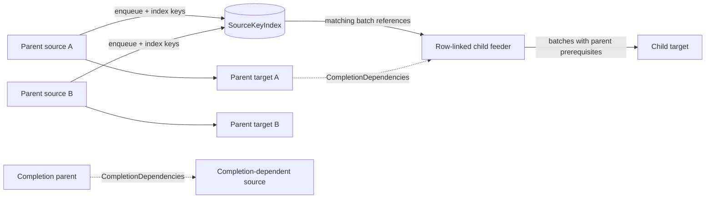
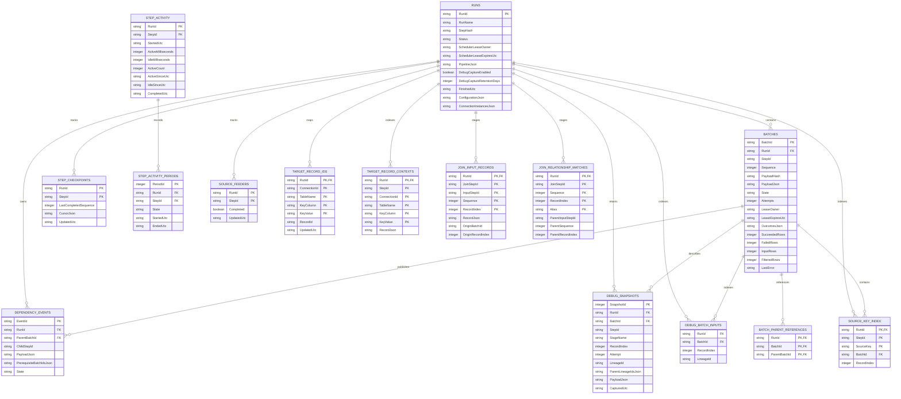
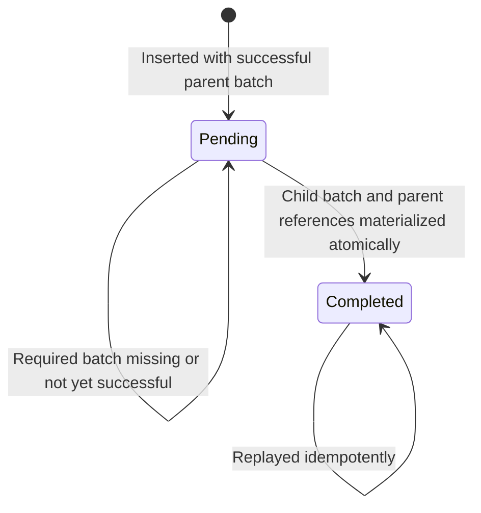

# Architecture and internal flows

This guide describes the current implementation, not a promise of complete KingswaySoft parity or a production-ready generic migration product. See the [feature plan](../../PLAN.md) for current scope and outstanding work.

## System boundaries

There are five binary PowerShell cmdlets, a read-only local monitoring UI/API, a separate transformation API, and a local SQLite owner service:

1. **The binary PowerShell cmdlet** [`Invoke-Migration`](../../src/Migration4Dataverse.Engine/PowerShell/InvokeMigrationCommand.cs) accepts a top-level `Steps` DAG. [`PowerShellMigrationStepFactory`](../../src/Migration4Dataverse.Engine/PowerShell/PowerShellMigrationStepFactory.Graph.cs) converts Source, Join, Transform, Filter, Append, Target, and callback nodes into [`MigrationStepDefinition`](../../src/Migration4Dataverse.Engine/Scheduling/MigrationStepDefinition.cs) objects for the shared [`DependencyScheduler`](../../src/Migration4Dataverse.Engine/Scheduling/DependencyScheduler.cs). Keyed source and join inputs declare their row-flow dependencies; `DependsOn` is reserved for additional whole-step completion barriers. A two-input Join stages and indexes inputs on disk, emits matches incrementally, then sends one nested row to a one-input Transform. Callback mode supports explicit multi-parent batch readiness through `MigrationDependencyOutput.RequiredBatchIds`.
2. **The data-flow API** in `Migration4Dataverse.Engine.Transformations` remains a separate named transformation DAG. PowerShell callers define it with hashtables and inline Transform and Filter script blocks; the engine internally binds those scripts to their node IDs. Its stream-wide Sort and Merge operators are not yet wired into `Invoke-Migration`.
3. **The dashboard** [`MigrationDashboardServer`](../../src/Migration4Dataverse.Engine/Dashboard/MigrationDashboardServer.cs) hosts the built React/React Flow SPA and a read-only API over the same SQLite file. It binds only to a loopback URL. Basic run/step/batch metadata is always retained; row payload snapshots are opt-in except for `Invoke-Migration -WhatIf`, which captures planned target inputs.
4. **The database owner** is hosted by the first caller that opens a database, or explicitly with `Start-MigrationDatabaseServer`. It is the only Migration4Dataverse process that opens that SQLite file; other processes use same-user named-pipe IPC. Scheduler execution, workers, live connections, and callbacks remain in each caller process. A database can serve multiple active run IDs, with per-run leases preventing duplicate schedulers for the same run.
5. **Run history** is queryable through [`Get-MigrationRun`](../../src/Migration4Dataverse.Engine/PowerShell/GetMigrationRunCommand.cs). The dashboard can also preview caller-supplied step and connection objects without starting a migration or opening a database.

```mermaid
flowchart LR
    config["Top-level Source / operation / Target steps"]
    connections["Caller-owned named connection objects"]
    scriptConfig["Run-wide helper scripts and required modules"]
    invoke["Invoke-Migration"]
    sourceFeeder["Source step feeder"]
    sourceCount["Optional source count preflight"]
    completionGate["Step completion tracker"]
    readerFactory["Connector record-reader factory"]
    fileReaders["JSONL / CSV / Parquet readers"]
    parquetCounts["Parquet footer metadata"]
    databaseReaders["SQLite / DuckDB query readers"]
    dataverseSource["Dataverse query reader"]
    customSource["Paged custom source callback"]
    runspaces["Pooled PowerShell handlers and callbacks"]
    previewGate{"WhatIf preview?"}
    previewRows["Capture planned target rows"]
    targetType{"Target.Type"}
    throughput["Run-wide successful target throughput"]
    targetTuner["Pipeline batch tuner"]
    connectionController["Shared per-connection Dataverse controller"]
    retryMonitor["Connection retry / throttle telemetry"]
    commands["Rnwood.Dataverse.Data.PowerShell"]
    dataverse["Microsoft Dataverse"]
    joinStaging["SQLite Join input rows and key indexes"]
    joinReader["Indexed streaming Join reader"]
    fileWriter["Atomic per-batch file writers"]
    databaseWriter["Transactional SQLite / DuckDB writers"]
    databaseTransform["SQLite PowerShell / DuckDB prepared transform"]
    customTarget["Custom target callback"]
    output["Per-step, per-run batch files"]
    pipeline["Separate data-flow pipeline"]
    caller["C# API caller"]
    dashboard["React / React Flow dashboard"]
    browser["Local browser"]

    subgraph engine["Shared C# engine"]
        scheduler["DependencyScheduler"]
        storeClient["MigrationStoreFactory / IMigrationStore"]
        dashboardServer["MigrationDashboardServer"]
        psExecutor["PowerShellScriptExecutor"]
    end
    subgraph owner["Per-database SQLite owner process"]
        rpcServer["Same-user named-pipe RPC server (bounded reusable listeners)"]
        writeGate["Owner-process SQLite write gate"]
        store["SqliteMigrationStore / run data / tuning profiles"]
    end

    config --> invoke
    connections --> invoke
    scriptConfig --> invoke
    invoke --> scheduler
    scheduler --> sourceCount
    sourceCount -->|wrapped Query / optional CountQuery| databaseReaders
    sourceCount -->|RecordCount| dataverseSource
    sourceCount -->|row-group metadata| parquetCounts
    sourceCount -->|CountCallback| psExecutor
    sourceCount -->|resolved expected totals| storeClient
    scheduler --> completionGate
    invoke -- sanitized config and connection snapshots --> storeClient
    sourceFeeder --> scheduler
    scheduler --> storeClient
    dashboardServer --> storeClient
    storeClient -->|direct in owner process; IPC otherwise| rpcServer
    rpcServer --> writeGate --> store
    browser --> dashboard
    dashboard --> dashboardServer
    scheduler --> psExecutor
    psExecutor --> runspaces
    invoke --> sourceFeeder
    invoke --> readerFactory
    readerFactory --> fileReaders
    readerFactory --> databaseReaders
    readerFactory --> dataverseSource
    readerFactory --> customSource
    fileReaders --> sourceFeeder
    databaseReaders --> sourceFeeder
    dataverseSource --> runspaces --> commands
    dataverseSource --> sourceFeeder
    customSource --> runspaces
    customSource --> sourceFeeder
    runspaces --> previewGate
    previewGate -->|execute| targetType
    previewGate -->|preview: skip target and callback side effects| previewRows --> storeClient
    runspaces -->|target batch outcomes| throughput
    runspaces -->|batch-size experiments| targetTuner
    targetTuner -->|one experiment at a time; pipeline throughput| throughput
    targetTuner -->|load/save batch profiles by step ID| storeClient
    targetTuner -->|selected batch size| targetType
    runspaces -->|shared execution permits| connectionController
    connectionController -->|connection retry/throttle observations| retryMonitor
    retryMonitor -->|reduce budget on throttle| connectionController
    connectionController -->|load/save versioned connection budget| storeClient
    connectionController -->|shared target concurrency| targetType
    targetType -- dataverse --> commands --> dataverse
    runspaces --> joinStaging --> storeClient
    commands -->|returned target IDs| runspaces
    storeClient -->|completed input pages and key matches| joinReader --> scheduler
    targetType -- jsonl / csv / parquet --> fileWriter --> output
    targetType -- sqlite / duckdb --> databaseWriter
    runspaces --> databaseTransform
    targetType -- custom --> customTarget
    caller -->|definition, sources, and node scripts| pipeline
    pipeline --> psExecutor
```



### Typed connectors and named connections

Each Source or Target step declares a connector `Type` and `ConnectionId`. The caller supplies the corresponding runtime objects in a map keyed by ID; secrets are not stored in step data. `New-MigrationDatabaseConnection` creates built-in SQLite or DuckDB ADO.NET connection objects without caller-side assembly loading. Sources support JSONL, CSV, Parquet, SQLite and DuckDB SQL queries, Dataverse queries, and paged PowerShell callbacks. Database query results stream from ADO.NET readers. Dataverse source queries use `Get-DataverseRecord` Simple/FetchXML modes or read-only Sql4Cds queries through `Invoke-DataverseSql`; results stream through the runspace pool with bounded buffering. Targets support Dataverse, JSONL, CSV, Parquet, SQLite, DuckDB, and PowerShell callbacks. Types and connection IDs may vary by step. There is not yet a general connector registry or plug-in API.

For a Dataverse source or target, the connection map contains the module connection. Steps sharing a Dataverse target connection are serialized by a semaphore. Built-in file connectors receive a directory connection. Their source and target paths are resolved relative to that directory. JSONL, CSV, and Parquet targets write each batch to a separate file under the target step path and run ID using a temporary file and atomic move; an identical replay is accepted and conflicting content is reported. File targets require no Dataverse connection or schema setup. Custom callbacks receive the caller's connection object; custom targets must implement their own replay-safe write behavior.

SQLite and DuckDB connectors use their ADO.NET connection objects from `-Connections`; database source steps issue `Options.Query`, and database targets insert records into `Table`. A database target creates a missing table from the first non-empty batch by default, or creates/checks it against an explicit `Options.Schema`. Existing names and types are verified before each write. Each write and its run/step/batch content hash marker commit in one transaction, so identical scheduler retries are idempotent. A shared database connection is gated across readers, writers, and connection-backed transforms; separately configured database IDs allow source and target work against different files concurrently.

Dataverse queries rerun from the beginning when resuming; the source reader replays records through the last completed source cursor. Simple queries automatically order by `Source.Key` unless an `OrderBy` is supplied with ascending `Key` first. FetchXML, SQL, and custom readers should provide a stable ascending `Key` order. Root source keys must be unique and strictly increasing using case-insensitive ordinal comparison for Dataverse sources, matching platform collation; other root sources use ordinal comparison. Row-linked child sources are staged internally and need not be grouped by parent. Child keys must be unique within each non-null parent relationship.

[`PowerShellScriptExecutor`](../../src/Migration4Dataverse.Engine/PowerShell/PowerShellScriptExecutor.cs) imports requested modules into a runspace pool, makes configured helper scripts available to each invocation, executes scripts asynchronously with cancellation, and raises `PowerShellScriptException` when PowerShell reports errors. `-RequiredModules` resolves installed PowerShell module specifications and enforces requested version constraints; their resolved versions and helper script contents participate in the default resume hash. Its bounded streaming output path allows Dataverse source results to be batched without buffering the full query. Migration step handlers execute Transform/Filter scripts and dispatch Target batches to the selected connector; custom connector modules are imported into the pool so callbacks can use their dependencies from runspaces.

When a Join references Dataverse Target steps, those Targets appear as the right-hand row-flow input. Producers persist each required input row and configured join-key projection to run-scoped SQLite staging as their batches complete; Target rows include the final GUID returned by `Set-DataverseRecord -PassThru`. The indexed reader processes left rows in their stable sequence and probes the durable parent-key index as parent rows become available. Matches are emitted before either side completes; non-null unmatched keys are resolved only after the right-hand step completes, while null or blank keys never match. `inner` filters unmatched rows; `left` retains them with the parent alias set to `$null`. A Join may also use a Source as its parent input. For whole-job sequencing, that Source can declare `DependsOn` on the terminal Target and reread its completed rows from Dataverse; the Join then incurs those additional reads instead of consuming Target output rows. Chained two-input joins support additional lookups and dotted child-key paths into a nested left row. Input ordering is not required; SQLite staging is removed after success and retained after failure for run recovery.

The other migration paths remain bounded by batch or row: connector readers yield batches, Transform and Filter invoke scripts per row, Append processes its input streams sequentially, targets process one batch at a time, and database transforms are per-row. Standalone Merge uses one-row lookahead per input. Standalone Sort uses bounded in-memory runs and temporary disk spill; no operator-wide in-memory row collection is used.

Database-backed migration Transform nodes are per-row: SQLite invokes its PowerShell `Script` with the row and live connection, while DuckDB can invoke the same script contract or run a prepared SQL statement using positional parameters. Per-batch and whole-dataset database transforms are not implemented.

### Data-flow transformations

[`DataFlowPipelineDefinition`](../../src/Migration4Dataverse.Engine/Transformations/DataFlowPipelineDefinition.cs) validates a named acyclic graph, and [`DataFlowPipeline`](../../src/Migration4Dataverse.Engine/Transformations/DataFlowPipeline.cs) executes it pull-first. PowerShell consumers author configuration as hashtables and place scripts inline in each Transform or Filter node's `Script` property; the pipeline API extracts them into its internal node-ID map. Append/Union All and Merge stream records; Merge keeps one-row lookahead per side and validates the configured ordering. Transform can emit zero or more JSON objects per input row, while Filter uses script output truthiness to keep or discard the original row. Sort is stable and external: it writes bounded sorted runs and performs pairwise merge passes under the configured memory, row, record-size, and spill limits.

The migration graph supports multiple consumers and Source, Append/Union All, Join, Target, Transform, Filter, and callback nodes. Stream-wide Sort and Merge remain available in the separate data-flow API only; graph Join is a separate keyed row-combination step and does not redefine Merge. See the [transformation reference](../transformations/README.md) for its schema and operator details.

## Scheduler contracts

The public C# contracts are in the [scheduling source folder](../../src/Migration4Dataverse.Engine/Scheduling/):

- A `MigrationStepDefinition` has a unique ID, node type, declared input step IDs, an optional source callback, and a batch handler. A reader may identify a root source or a streaming Join reader.
- Join is the only source-driven step allowed to consume non-source inputs. It reads persisted input rows incrementally and may emit matches before the producers finish. Its default `JoinOrder = 'ready'` defers unavailable child keys and emits later ready matches without preserving left-input order; `JoinOrder = 'stable'` preserves that order and can wait behind an unavailable key. Unmatched keys resolve when the parent finishes. Other source-driven steps continue to require source-driven inputs.
- `CompletionDependencies` is a separate all-of barrier. Source feeders wait before reading; row-linked dependency events also wait before materialization. A dependency step completes only after its upstream steps finish and its own batches and incoming dependency events drain.
- The scheduler validates step IDs and input references and rejects invalid graphs such as cycles or a graph without a root reader.
- A root callback receives its `MigrationStepCheckpoint` and a cancellation token, then streams `MigrationWorkBatch` values. Each batch carries JSON payload and optional cursor-after JSON. Root sources should be incremental and replayable rather than buffering an entire table.
- A handler receives a leased `StoredBatch` and returns a `MigrationBatchResult` containing JSON outcomes, an error flag, and optional `MigrationDependencyOutput` values.
- Each dependency output names a declared child step and contains JSON payload. `RequiredBatchIds` can add explicit prerequisites for multi-parent work. Every prerequisite must belong to this run, be a declared input of the child, and succeed before the child batch is released.
- The scheduler creates batch identities from run, step, and sequence. Replaying an existing identity requires the same durable payload and cursor; a different definition uses a different run ID and step hash.

`Inputs` declares which steps can publish dependency work; it does not implicitly join all batches from all inputs. For a multi-parent gate, the producer must provide the required batch IDs in the dependency output. That gate does not itself join or transform records.

The PowerShell graph's `Inputs` declares row flow and implicitly declares dependencies. A keyed source input uses `Job` and `Keys = @{ Child = ...; Parent = ... }` to link a child source to a parent source; the parent name must equal the parent's `Source.Key`. A row with a null key for one parent is retained without waiting on that relationship, while its other non-null relationships still wait for matching parent batches. A non-null key with no matching parent fails the run. `RowsPerParent` can enforce fixed fan-out independently for each relationship; omitted or zero means variable fan-out, including parents with no children. `DependsOn` accepts only additional step IDs used as completion barriers. Row-linked sources are staged internally, so their input need not be grouped by foreign key.



## Scheduler lifecycle

[`DependencyScheduler.ExecuteAsync`](../../src/Migration4Dataverse.Engine/Scheduling/DependencyScheduler.cs) validates the graph and options, creates or verifies the run against its name and step hash, and acquires an exclusive lease for that run ID. Distinct run IDs can execute concurrently against one database through its owner process. The scheduler then starts root feeders, the worker pool, a dependency-event pump, and a per-run lease heartbeat concurrently.

```mermaid
sequenceDiagram
    autonumber
    participant Caller
    participant Scheduler
    participant Root as Source feeder
    participant Keys as Source-key coordinator
    participant Completion as Step completion tracker
    participant Store as SQLite store
    participant Workers as Bounded workers
    participant Gate as Target permit / queue budget
    participant Handler as Batch handler
    participant Pump as Dependency event pump
    participant Join as Indexed Join reader

    Caller->>Scheduler: ExecuteAsync(run, hash, steps, options)
    Scheduler->>Store: CreateRun and acquire run-scoped scheduler lease
    Scheduler->>Store: Read progress and step checkpoints

    par Source feeders
        Scheduler->>Completion: Await DependsOn parents before reading
        Completion-->>Scheduler: Parent steps drained
        Scheduler->>Store: Read completed checkpoint and latest enqueued cursor
        Store-->>Scheduler: Completed checkpoint + durable resume position
        Scheduler->>Root: ReadSourceBatches(resume checkpoint, token)
        Root-->>Scheduler: Work batch and cursor
        Scheduler->>Store: Enqueue payload and source-key index
        Root->>Keys: Signal parent source completion
        Keys-->>Root: Release waiting key requests or fail unmatched keys
    and Worker pool
        Workers->>Gate: Try acquire target execution permit
        Gate-->>Workers: Permit or unavailable
        Workers->>Scheduler: Reserve downstream queue capacity
        Workers->>Store: TryLeaseNextBatch
        Store-->>Workers: Leased batch
        Workers->>Handler: Execute batch
        Handler-->>Workers: Outcomes and dependency outputs
        Workers->>Store: CompleteBatch with outputs and checkpoint
        Workers->>Scheduler: Release producer reservation and execution permit
    and Dependency event pump
        Pump->>Store: Read pending events by keyset page
        Pump->>Completion: Check child completion dependencies
        Completion-->>Pump: Ready or still waiting
        Pump->>Scheduler: Reserve one child batch slot
        Pump->>Store: TryMaterializeDependencyEvent
        Store-->>Pump: Child batch when prerequisites succeeded
    end

    Note over Store,Keys: Batch enqueue and source-key indexing are transactional.
    Note over Store,Pump: Dependency-event inserts and checkpoint advancement are transactional.
    Note over Store,Workers: Batch leasing acquires the WAL writer slot before selecting a batch; other read-modify-write operations serialize before reading, while WAL readers remain concurrent.
    Note over Caller,Store: IMigrationStore is a local call when the caller owns the database, otherwise a same-user named-pipe request to its single SQLite owner.
    Note over Store: The owner centralizes SQLite connections and write serialization; it does not host schedulers, workers, callbacks, or live connector objects.
    Join->>Store: Scan completed left rows and restore deferred row cursors
    Join->>Store: Probe successful parent rows by durable key index
    Store-->>Join: Matching parent rows from completed batches
    Join-->>Scheduler: Emit ready matches incrementally (default; may reorder)
    Join->>Completion: Resolve deferred keys when the parent finishes
    Note over Join,Store: JoinOrder = stable waits at each left row and preserves input order.
    Workers->>Store: Lease and execute materialized child batches
    Scheduler->>Store: Mark run completed and release run lease
```

### Sources, workers, and backpressure

- Before creating run metadata, the scheduler resolves supported source counts once. SQLite/DuckDB wrap the main `Query` in a scalar count query unless an explicit `CountQuery` override is supplied; Simple and FetchXML Dataverse sources use `Get-DataverseRecord -RecordCount`; custom sources can invoke a `CountCallback`; and Parquet sources read row counts from file metadata. Cds4Sql, CSV, and JSONL sources do not scan their contents to calculate a total; without an explicit `ExpectedRecordCount`, their totals become known as rows flow. Positive explicit or resolved counts are checked against the source rows when enumeration completes, including an expected total of zero.
- Each root feeder preserves the last contiguous completed sequence and cursor, and separately resumes source enumeration after the latest durably enqueued batch. Pending and in-flight batches remain authoritative in SQLite and are processed from their stored payloads; the feeder does not regenerate them. Every new JSON batch is durably enqueued before a worker can write it.
- A root source with completion dependencies waits for every referenced step to drain before opening its source reader. Completion is derived recursively from upstream completion, in-flight batches, and pending incoming dependency events; parent failures fail the run.
- A row-linked source has its own source feeder and stages its rows in a temporary SQLite database. Each keyed `Inputs` entry identifies a parent Source and maps the child `Child` property to that parent's `Source.Key` through `Keys.Parent`. The feeder releases null-containing rows first (without a batch prerequisite for null relationships), then linked rows as all matching parent batches become available. If the child source has explicitly declared completion barriers, the feeder waits for those steps before reading.

Join readers stage both input streams in SQLite and use a durable key index for parent lookups. In the default ready mode, the reader advances through completed child rows, retaining positions for keys not yet present in the parent index while emitting available matches; those outputs may be out of left-input order. The checkpoint stores the scan position and deferred row references, so a restart can continue resolving them. Once the parent completes, remaining keys become unmatched left rows or filtered inner rows. Stable mode instead waits on each child row in sequence before advancing.
- Row-linked sources support either a positive fixed `RowsPerParent` count per relationship or variable fan-out when the setting is omitted or zero. Each non-null key must match a parent key; missing matches fail. Explicit JSON null represents an absent relationship, while missing or blank key properties are invalid. Rows with all relationships null have no parent-batch prerequisites. Input need not be grouped or ordered by foreign key; staging sorts by null status, parent-key tuple, and child key.
- `MaxQueuedBatches` (default 64) bounds pending plus in-flight batches, while `MaxQueuedBatchesPerStep` (default 32) bounds each step's outstanding batches and producer reservations. Producers reserve downstream capacity before leasing work; the dependency pump incrementally materializes multi-batch fan-out only when a child slot is available, skipping full consumers instead of blocking sibling branches. Durable, prerequisite-blocked dependency events do not consume materialized-batch capacity.
- The SQLite owner is the only Migration4Dataverse process that opens its database. Caller-side `IMigrationStore` clients use an in-process implementation when local, or a same-user named-pipe request when remote. The owner maintains a bounded pool of eight reusable pipe listeners; each listener handles one request at a time, avoiding concurrent listener recreation while still serving multiple requests concurrently. Inside the owner, WAL supports concurrent readers and a per-database write gate serializes mutations because SQLite permits only one writer at a time. Selected lease and worker persistence operations retain bounded `BUSY`/`LOCKED` retries with exponential backoff and jitter for contention outside that gate; unrelated SQLite errors remain visible and fail the run. The owner lock is released automatically when its process exits, so clients can reconnect by reopening the store after a crash; an in-progress caller must be restarted to resume its run.
- Root feeders use their own bounded share of the global batch queue and do not wait on ready dependency events across the whole graph; worker-level dependency priority preserves prompt child execution without pausing unrelated roots.
- `MaxDegreeOfParallelism` controls the number of workers and is limited to 32. SQLite work remains shared, while handlers execute concurrently up to this bound; target-specific semaphores may further limit concurrent writes.
- Ready materialized dependency batches are prioritized over queued root batches, allowing child work to start after its parent batch succeeds rather than waiting for the root source to finish. Within each dependency-priority group, a weighted-fair dispatcher combines graph-derived pipeline impact with the current ready-batch backlog. More impactful, backlogged work gets more dispatches, while service counts and rotation ensure lower-weight ready steps are not starved. Workers acquire target execution permits and downstream queue capacity before leasing batches.
- Dependency events are read in keyset pages ordered by `(CreatedUtc, EventId)`. A pending event whose prerequisites are not complete remains pending; the pump continues looking for later events so a blocked earlier event does not starve ready work.
- The run completes only after root feeders finish and there are no outstanding non-terminal batches or pending dependency events.

Dataverse target tuning is coordinated at two levels. A `PipelineThroughputMeter` records successful rows written across all Dataverse targets. Auto batch-size experiments are per target but serialized across the run, so candidate choices are scored against whole-pipeline output rate rather than an isolated target rate. A target starts from a configured or persisted batch size, samples completed batches per candidate, and stops after consecutive candidates fail to improve throughput by at least five percent. Candidates are capped by the invocation batch size and 1,000.

Auto concurrency uses one `PipelineAdaptiveDataverseConnectionController` per connection ID. Its budget applies to all auto-concurrency targets on that connection, bounded by the invocation's `MaxDegreeOfParallelism` (at most 32). The controller starts from the connection's `RecommendedDegreesOfParallelism` when available, otherwise a conservative default; it reduces the budget on detected throttle signals and only increases it when capacity is saturated, connection-log telemetry is available, and a throughput probe improves whole-pipeline output. The retry monitor enables in-memory ServiceClient logging temporarily, counts retry/throttle signals without storing raw entries, and restores the connection's original logging setting. Normal retries remain enabled. Diagnostic `-DataverseNoRetryDiagnosticMode` disables ServiceClient, cmdlet, and scheduler retries for the run, restoring the connection's original retry setting when disposed.

Batch-size profiles are keyed by target step ID. Shared concurrency profiles use algorithm version 2 and the connection ID; legacy per-target concurrency values are not reused. Compatible saved values are bounded by current invocation limits and can be cleared with `Clear-MigrationTargetTuning`. The scheduler worker limit remains global, so target or connection budgets never increase total scheduler parallelism. `Set-DataverseRecord` runs with internal parallelism one. Target `Options.MatchOn` selects alternate-key match behavior without `-Upsert`, which the connector module does not support together with `-MatchOn`; `Options.LookupColumns` resolves scalar lookup values against referenced-table key fields. A Join's parent key pairs must match an ordered `MatchOn` key group; staged Target rows contain mapped fields plus the final GUID in `Id`. Its indexed reader emits matches from successful parent batches without waiting for the full parent step; only unmatched non-null keys wait for parent completion. The caller is responsible for creating and owning target connections. General C# callers may configure handler concurrency according to their handler and connection-pool design.

### Batch completion, retries, and cancellation

A worker leases one batch, incrementing its attempt count, and renews that batch lease while its handler is running. A successful handler result is committed with `CompleteBatch`. A handler exception is retried up to `MaxAttempts` with exponential delay capped at one minute; before retrying, the batch is returned to `Pending`. Invalid handler results, exhausted retries, or a result with row errors are recorded as terminal failures and fail the run.

Successful completion atomically records outcomes, releases the batch lease, inserts dependency events, advances the table checkpoint, and removes the now-unneeded payload JSON. Outcomes may include optional step-specific specialist information; Dataverse targets record their current batch-size and concurrency tuning state for the dashboard. A batch with row errors retains its payload and error outcomes, releases no dependency work, and blocks resuming that run until the failures are resolved or exported.

When cancellation interrupts handler execution, the scheduler abandons the batch back to `Pending` before stopping. If another worker has already reclaimed a batch, the former owner cannot complete or abandon it; its stale outcome is discarded and the current lease owner controls the durable transition. Losing a batch lease alone does not fail the run. Persisted work can be resumed by reusing the same run ID and unchanged step definition after the run lease is available.

## SQLite persistence and recovery

[`SqliteMigrationStore`](../../src/Migration4Dataverse.Engine/Storage/SqliteJobStore.cs) requires a file-backed database. It enables WAL journal mode and configures foreign keys, `synchronous = FULL`, and a 30-second busy timeout. Scheduler read-modify-write operations begin immediate transactions so concurrent workers reserve SQLite's single WAL writer slot before reading, avoiding deferred-transaction upgrade races while allowing readers to continue. Ordered migrations are tracked in `SchemaMigrations` by version, name, and applied time; each migration and its ledger row commit in one transaction. Migration 1 creates the initial store. Migration 2 renames job/table identifiers to run/step identifiers while preserving their row data. Migration 3 adds persisted step runtime metrics and per-batch row totals. Migration 4 adds the legacy target-record ID mapping table. Migration 5 adds the legacy Target context table. Migration 6 adds Join input and match staging plus explicit batch-parent references. Migration 7 adds nullable per-batch input-row counts and filtered-row counts; uncountable callback payloads stay `NULL`, not zero. New batches are counted when queued, and successful completion may remove the original payload without losing the count. Migration 8 records step activity intervals for working-versus-waiting timelines; it does not reconstruct intervals for runs created before this migration. Migration 9 adds `SourceKeyIndex`, a durable mapping from each keyed source row to its queued batch and record index, written transactionally with batch enqueue. Migration 10 adds `JoinInputKeyIndex` for indexed streaming-join key lookups. Migration 11 adds an index that lets debug-snapshot retention cleanup seek by run and capture time. Migration 12 adds `DataverseTargetTuningProfiles`, which stores target tuning profiles independently of run history. Migration 13 adds the tuning algorithm version, and migration 14 adds the Dataverse connection ID used to validate shared concurrency profiles. Batch-size values remain target-step scoped; shared DOP is reused only from a compatible version-2 profile for the same connection. `Clear-MigrationTargetTuning` removes one or all profiles. Untracked legacy databases are rejected; create a fresh database when upgrading from a build that predates the migration ledger.
[`SqliteMigrationStore`](../../src/Migration4Dataverse.Engine/Storage/SqliteJobStore.cs) requires a file-backed database. It enables WAL journal mode and configures foreign keys, `synchronous = FULL`, and a 30-second busy timeout. Scheduler read-modify-write operations begin immediate transactions so concurrent workers reserve SQLite's single WAL writer slot before reading, avoiding deferred-transaction upgrade races while allowing readers to continue. A database-wide lease, acquired in an immediate transaction, excludes other active runs even when they use a different run ID or process. The write gate records wait and hold durations through the `Migration4Dataverse.Engine.Storage` meter. Ordered migrations are tracked in `SchemaMigrations` by version, name, and applied time; each migration and its ledger row commit in one transaction. Migration 1 creates the initial store. Migration 2 renames job/table identifiers to run/step identifiers while preserving their row data. Migration 3 adds persisted step runtime metrics and per-batch row totals. Migration 4 adds the legacy target-record ID mapping table. Migration 5 adds the legacy Target context table. Migration 6 adds Join input and match staging plus explicit batch-parent references. Migration 7 adds nullable per-batch input-row counts and filtered-row counts; uncountable callback payloads stay `NULL`, not zero. New batches are counted when queued, and successful completion may remove the original payload without losing the count. Migration 8 records step activity intervals for working-versus-waiting timelines; it does not reconstruct intervals for runs created before this migration. Migration 9 adds `SourceKeyIndex`, a durable mapping from each keyed source row to its queued batch and record index, written transactionally with batch enqueue. Migration 10 adds `JoinInputKeyIndex` for indexed streaming-join key lookups. Migration 11 adds an index that lets debug-snapshot retention cleanup seek by run and capture time. Migration 12 adds `DataverseTargetTuningProfiles`, which stores target tuning profiles independently of run history. Migration 13 adds the tuning algorithm version, and migration 14 adds the Dataverse connection ID used to validate shared concurrency profiles. Batch-size values remain target-step scoped; shared DOP is reused only from a compatible version-2 profile for the same connection. `Clear-MigrationTargetTuning` removes one or all profiles. Untracked legacy databases are rejected; create a fresh database when upgrading from a build that predates the migration ledger.

Dashboard input progress sums persisted `InputRows` by batch state and reports filtered rows separately. Root source totals may use a resolved source count provider or the positive configured `ExpectedRecordCount`; finalized step totals are derived after every upstream input has completed and pending dependency events are materialized. While a step is still receiving input, the dashboard recursively projects its total from upstream projected outputs and observed input/output ratios; if source totals are unknown or an upstream branch cannot be projected, it falls back to progress among currently materialized batches. The global target bar and ETA use projected target-write totals and observed target output throughput when available, and remain explicitly approximate until final counts are known.



The prerequisite batch IDs are stored as JSON in the dependency event rather than as foreign-key rows. `ParentBatchId` is a relational reference to the batch that emitted the event. Schema migration 002 renamed stored run, step, batch, checkpoint, dependency-event, and debug-snapshot columns while retaining their values; migration 003 adds persisted step runtime accounting and per-batch row totals; migration 004 adds target-record ID mappings.

| Store | Purpose |
| --- | --- |
| `Runs` | Run name/hash, run status, and scheduler lease owner/expiry. Reusing a run ID with a different run name or hash is rejected. |
| `Runs.PipelineJson` | Snapshot of step IDs, types, row-flow input IDs, completion dependencies, and source-backed status for monitoring; retained even when debug capture is disabled. |
| `Runs.ConfigurationJson` | Safe projection of the original PowerShell steps and named connection properties. Script blocks are represented by markers rather than executed or persisted as source. |
| `Runs.ConnectionInstancesJson` | Redacted connection property snapshots captured at run start and terminal completion; this retains diagnostics, not live connection objects. |
| `StepCheckpoints` | Last contiguous terminal batch sequence and its cursor for each run/step. Out-of-order completions do not skip gaps. |
| `SourceFeeders` | Per-source step completion marker, set only after enumeration ends and that source's nonterminal batches drain. Dashboard steps remain active until this marker and all dependency work are complete. |
| `Batches` | Durable payload and hash, sequence, status, attempt count, batch lease, outcomes, timestamps, and last error. Successful payloads are removed after commit; basic metadata/outcomes remain for dashboard history. |
| `Batches.SucceededRows` / `Batches.FailedRows` | Row totals parsed once when outcomes are committed; dashboard refreshes aggregate these columns in SQLite instead of deserializing every batch outcome repeatedly. |
| `StepActivity` | Per-step accumulated working/waiting durations and current activity state. A source step starts when its feeder starts; a dependent step starts when its first parent event is emitted. Active time spans source enumeration or at least one in-flight batch; waiting time accumulates while a started step has no active operation, including waits for parent rows or completion barriers. |
| `StepActivityPeriods` | Ordered working and waiting intervals used by dashboard timelines. Waiting includes scheduler inactivity and backpressure; it is not exclusively downstream blocking. |
| `DependencyEvents` | Durable child payload, parent batch, required parent batch IDs, and pending/completed state. |
| `TargetRecordIds` | Legacy run- and connection-scoped key-to-GUID mappings retained in existing store files; current handlers no longer read or write this table. |
| `TargetRecordContexts` | Legacy run- and Target-step-scoped context table retained for database compatibility; the streaming Join path uses the staging tables below. |
| `JoinInputRecords` | Per-Join child and parent rows staged as producer batches complete, with origin batch/record references for replay and debug lineage. Retained after failures and cleared after success. |
| `JoinRelationshipMatches` | Per-Join, per-alias parent matches written in bounded replay pages and read to stream child-ordered Join outputs. |
| `BatchParentReferences` | Direct parent batch references for replayed Join output batches, used to resolve debug lineage across batches. |
| `DebugSnapshots` | Opt-in redacted row/stage payloads, attempt and batch references, lineage IDs, and parent-lineage links. Retention is configured per run and is separate from basic migration metadata retention. |
| `DebugBatchInputs` | Compact input-record index to lineage-ID map for resolving cross-batch references; retained while the run is active and for its configured debug-retention period after completion. |

### Monitoring, debug capture, and lineage

The web app is built from `web/Migration4Dataverse.Dashboard` using Vite, React, Fluent UI 9 theme tokens, native controls, and `@xyflow/react`, then embedded in the engine assembly. `Start-MigrationDashboard` serves the SPA and read-only JSON endpoints from a loopback-only `HttpListener` host. It accepts a SQLite history database, in-memory step/connection objects for configuration preview, or both. The UI polls every three seconds. Its graph occupies the workspace between the header and collapsible summary/row panels, while configuration properties open in a collapsible right drawer. Every step remains a separate graph node; source and target connection details are derived from the sanitized configuration snapshot. Row inspection separates captured stages into searchable tabs, presents system metadata before payload properties, and can switch the payload between individual columns and JSON. Selecting a Dataverse source or target row with a captured primary ID provides a link to the environment's default model-driven app. Selecting a row moves the selected-row/highlight count to the graph heading and shows compact, multi-row previews at traced steps, replacing normal node details; the searchable row inspector retains the full trace. The dashboard derives completion from persisted source-feeder, batch, and pending dependency-event state. Per-step rows/second is the total successful plus failed rows divided by active step time; the UI displays throughput rates as rows per minute. Runtime hotspots use that same active duration instead of elapsed wall-clock span. The timeline draws persisted working and waiting intervals; waiting includes scheduler inactivity and backpressure, while runs predating migration 8 can show only an undifferentiated observed batch window. Step summaries aggregate pre-counted batch rows in SQLite rather than reparsing all outcome payloads. Streaming sources may not disclose total rows or bytes; when source counts are available, the dashboard recursively projects intermediate and target totals from upstream outputs and observed row ratios, and marks projected progress and ETA values as estimates until finalized counts are known. The orange graph path is the longest observed dependency activity chain, not a guaranteed scheduler critical path.

Every new run persists its step graph, sanitized step/connection configuration, connection instance snapshots, and batch/run operational metadata regardless of debug settings. Name-based redaction masks common credential/password/secret/token fields; it cannot identify arbitrary sensitive values. `-EnableDebugCapture` separately retains input snapshots, per-step outputs, callback-supplied `MigrationDebugStage` payloads, dependency child rows, and outcomes/errors. Debug capture is opt-in, SQLite is not encrypted by this feature, and operators must secure the database file.

Lineage IDs use stable record key fields when available and per-batch record positions otherwise. A mapped stage preserves its input lineage by record position unless a callback supplies `MigrationDebugStage.ParentRecordIndices`, which maps each output record to one or more zero-based input-record indices from the current batch. For a merge across stored batches, `MigrationDebugStage.ParentRecordReferences` maps each output record to `(BatchId, RecordIndex)` references in the current batch or one of `StoredBatch.ParentBatchIds`. The scheduler resolves references against the compact `DebugBatchInputs` index, validates that they belong to the child batch's direct parents, and stores every referenced lineage ID. These two explicit mapping forms are mutually exclusive. The trace query follows every parent relationship recursively in both directions. The compact input-lineage index remains for the active run and the configured retention period after it finishes, while row payload snapshots expire from their capture time. Selecting a graph step loads paged, searchable snapshots for each captured input and output stage; selecting a row highlights the related steps and dependency edges. Custom handlers should provide explicit mappings when outputs are reordered, merged, split, or otherwise do not map one-to-one by position, and otherwise keep record order stable inside a batch. Snapshot retention defaults to 30 days (configurable from 1 to 3650); expired snapshots are purged on dashboard startup and during later capture. Run/step/batch metadata, outcomes, and checkpoints are not deleted by this setting.

### Durable batch and dependency-event states

```mermaid
stateDiagram-v2
    state "Pending" as Pending
    state "InFlight" as InFlight
    state "Succeeded" as Succeeded
    state "CompletedWithErrors" as CompletedWithErrors

    [*] --> Pending
    Pending --> InFlight: Lease batch; increment attempts
    InFlight --> Pending: Abandon for retry or cancellation
    InFlight --> InFlight: Re-lease after lease expiry
    InFlight --> Succeeded: Complete without row errors
    InFlight --> CompletedWithErrors: Row errors or terminal handler failure
    Succeeded --> [*]
    CompletedWithErrors --> [*]
```



An expired batch lease allows another worker to reclaim the batch. The external operation may already have happened before a crash, so leases provide recoverability, not exactly-once side effects. Handlers that write to Dataverse must be replay-safe, for example by using upserts or a deliberate reconciliation strategy.

Dependency events follow a separate state transition:



The event pump materializes a child only when its publishing parent and all required parent batches have succeeded in the same run. In one SQLite transaction, the store inserts the child batch and marks the event complete. Reprocessing an already-completed event returns its existing child batch. The child `StoredBatch.ParentBatchIds` exposes the publishing and required parent batches to its callback, derived from the durable dependency event. This lets a callback declare lineage references to rows in multiple direct parents without combining or changing their payloads.

### Recovery model and guarantees

1. The caller reuses the run ID, run name, step hash, and logically identical source/handler definitions.
2. The scheduler verifies the stored run identity, acquires the run lease, reads current progress, and refuses to resume a run with batches already recorded as having row errors.
3. A root source receives both the last contiguous completed checkpoint and the latest durable enqueue position (`ResumeSequence` and `ResumeCursorJson`). It continues after the latest enqueued batch; pending and in-flight batches are replayed from SQLite rather than reconstructed from potentially changed parent readiness. The store still checks payload hashes and cursors when an identity is explicitly enqueued again.
4. Pending batches are leased normally. Expired in-flight batches can be reclaimed; pending dependency events are paged and materialized as their prerequisites become successful.
5. A handler may run again if the process failed after the external write succeeded but before SQLite committed completion. Dataverse operations therefore need to be safe to replay.

Default scheduler settings are defined in `DependencySchedulerOptions`: four workers, eight queued batches, five attempts, a 30-minute batch lease, a one-minute run lease, a 250-millisecond poll interval, and a two-second initial retry delay. The retry delay grows exponentially up to one minute. These are defaults, not service-protection guarantees; automatic connection control depends on usable connection logging and telemetry.

## Step graph and callback execution

[`PowerShellMigrationStepFactory`](../../src/Migration4Dataverse.Engine/PowerShell/PowerShellMigrationStepFactory.Graph.cs) parses node IDs, types, row-flow inputs, source completion/row-linked dependencies, connector definitions, and inline scripts, validates the DAG, and creates source readers and handlers. The generated step hash covers step definitions and module references, and versions the row-linked source contract to prevent unsafe resume of runs without a source-key index. WhatIf previews add a distinct hash suffix, execute sources and transforms while capturing their rows, and skip typed target writes and callback handlers. Their PowerShell result sets `DependencySchedulerResult.IsWhatIf`; target rows are processed for preview but are not counted as successful writes. Root and row-linked Source nodes read connector streams; a Transform, Filter, or Append node consumes batches routed by its declared input IDs.

[`DependencyScheduler`](../../src/Migration4Dataverse.Engine/Scheduling/DependencyScheduler.cs) resolves configured source count providers before persisting expected totals, then durably queues root batches and tracks completion of every step. Typed handlers dispatch Target steps to Dataverse, atomic JSONL/CSV/Parquet batch writers, or custom connector callbacks. Successful step batches release bounded work for each declared consumer; SQLite commits dependency events transactionally with producer completion. Source completion barriers wait for the complete referenced step, while row-linked source edges stream nested rows from parent source batches. Callback nodes can add explicit `RequiredBatchIds` for multi-parent batch readiness. That readiness mechanism does not join record payloads, and typed stream-wide Merge and Sort nodes are not yet integrated into this execution path.

`MaxDegreeOfParallelism` controls scheduler workers and caps each shared Dataverse connection budget. Dataverse batch-size candidates are serialized and scored against run-wide successful target throughput; auto concurrency is shared per connection and reacts to observed retry/throttle telemetry. `Set-DataverseRecord` uses internal parallelism one. Custom targets use their configured callback concurrency limit. The invoker retains ownership of supplied connections. Normal retries remain on; the opt-in `-DataverseNoRetryDiagnosticMode` disables connection, cmdlet, and scheduler retries for a diagnostic run.

Reusing the run ID resumes from durable source checkpoints, dependency events, and source-key indexes. The source and step hash prevent silently resuming with changed inputs, scripts, or target identity/output location. Generated hashes for row-linked steps include a reader-contract version; callers who supply a custom hash must change it when that contract changes. Custom sources must be stable and replayable so the reader can re-read through the last completed key. See the [step configuration](../configuration.md), [concepts](../concepts/README.md), and [Invoke-Migration contract](../cmdlets/invoke-migration.md).

## Related implementation

- [Scheduling source](../../src/Migration4Dataverse.Engine/Scheduling/) — step definitions, batch contracts, and the C# dependency scheduler.
- [Connector source](../../src/Migration4Dataverse.Engine/Connectors/) — file and database readers/writers, database connection gating, and connector options.
- [Transformation source](../../src/Migration4Dataverse.Engine/Transformations/) — named DAG validation, streaming nodes, sort-key comparison, and external merge sorting.
- [Storage source](../../src/Migration4Dataverse.Engine/Storage/) — SQLite schema, leases, checkpoints, and dependency-event transactions.
- [PowerShell executor source](../../src/Migration4Dataverse.Engine/PowerShell/) — embedded PowerShell runspace-pool executor.
- [`InvokeMigrationCommand.cs`](../../src/Migration4Dataverse.Engine/PowerShell/InvokeMigrationCommand.cs) — binary PowerShell entry point.
- [`PowerShellMigrationStepFactory.Graph.cs`](../../src/Migration4Dataverse.Engine/PowerShell/PowerShellMigrationStepFactory.Graph.cs) — PowerShell node parser and connector/handler factory.
- [Public reference](../reference.md) — index for cmdlets, configuration, concepts, connectors, and transformations.
- [PLAN.md](../../PLAN.md) — current feature inventory and open work.
